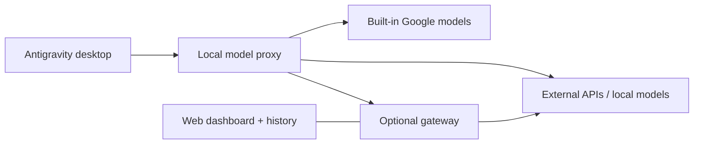

<div dir="rtl">

<p align="center">
  
</p>

<h1 align="center">تمكين النماذج المخصصة في Antigravity</h1>

<p align="center">
  <strong>مزودوك ونماذجك المحلية، داخل Antigravity.</strong><br>
  إدارة النماذج لتطبيق سطح المكتب وAntigravity IDE، مع بوابة اختيارية.
</p>

<p align="center">
  <a href="https://github.com/vahapogut/antigravity-add-model/actions/workflows/ci.yml"></a>
  <a href="#installation"></a>
  <a href="LICENSE"></a>
</p>

<p align="center" dir="ltr">
  <a href="README.md">English</a> · <a href="README_zh.md">简体中文</a> · <a href="README_es.md">Español</a> · <a href="README_tr.md">Türkçe</a> · <a href="README_ru.md">Русский</a> · <a href="README_hi.md">हिन्दी</a> · <strong>العربية</strong>
</p>

<p align="center">
  <a href="#installation"><strong>البدء السريع</strong></a> ·
  <a href="#quick-links">روابط سريعة</a> ·
  <a href="#screenshots">لقطات الشاشة</a> ·
  <a href="#documentation">الوثائق</a> ·
  <a href="https://github.com/vahapogut/antigravity-add-model/issues/new">الإبلاغ عن مشكلة</a>
</p>

---

أضف مزودي واجهات API الخارجية والنماذج المحلية إلى جانب نماذج Antigravity المدمجة. اضبطها في الإعدادات، وبدّل النماذج من قائمة المحادثة، ووجّه الطلبات اختياريًا عبر بوابة تضم سجلًا للطلبات ومزودين احتياطيين ولوحة تحكم في المتصفح.

> [!IMPORTANT]
> يستخدم **وكيل سطح المكتب المستقل المبني على Electron** مُثبّت الإضافة الموضّح أدناه. أما **Antigravity IDE المبني على VS Code**، وهو تطبيق منفصل، فيستخدم [محوّل الإعدادات ومدير الويب المحلي](docs/ide.md) الخاصين به. جرى التحقق على Windows مع IDE **2.5.5** من تسجيل الدخول، واختيار النماذج من قائمة IDE الأصلية، وبث المحادثات، باستخدام مزود محلي متوافق مع OpenAI؛ راجع [نتائج التحقق](docs/ide.md#validation-boundary). ينطبق توجيه النماذج المخصصة على الجلسات المحلية، مع الحفاظ على توجيه WSL الخاص بالمزود الأصلي. راجع [التوافق](docs/compatibility.md) قبل التثبيت.

الوثائق التقنية المرتبطة في هذا الدليل متاحة باللغة الإنجليزية حاليًا. أبقينا أسماء الأزرار والحقول كما تظهر في واجهة التطبيق لتسهيل اتباع الخطوات.

<a id="quick-links"></a>

## روابط سريعة

| البدء | الإعداد والاتصال | المساعدة والمشروع |
| --- | --- | --- |
| [التثبيت](#installation) | [البوابة ولوحة التحكم على الويب](#optional-gateway-and-web-dashboard) | [تشخيص المشكلات والاستعادة](#updates-diagnostics-and-recovery) |
| [إضافة أول نموذج](#add-your-first-model) | [الاتصال من حاسوب آخر](#connect-from-another-computer) | [إصدارات التطبيق وبُنى التثبيت المدعومة](docs/compatibility.md) |
| [المزودون وكتالوجات النماذج](docs/providers.md) | [إعداد النماذج](docs/configuration.md) | [سجل التغييرات](CHANGELOG.md) |
| [التطوير والمساهمة](#development-and-contributing) | [إعداد حسابات Google](docs/configuration.md#google-cloud-code-account-pools) | [تصفح المشكلات الحالية](https://github.com/vahapogut/antigravity-add-model/issues) |
| [إعداد Antigravity IDE](docs/ide.md) | [مقارنة الميزات استنادًا إلى الشيفرة المصدرية](docs/feature-parity.md) | [حالة IDE والاستعادة](docs/ide.md#status-and-recovery) |
| [معالج إعداد Cloudflare](docs/workers-ai-setup.md) | [سلاسل النماذج الاحتياطية](docs/providers.md#fallback-chains-for-rate-limited-providers) | [أمان الوكيل المحلي](docs/compatibility.md#local-proxy-trust-boundary) |

<a id="what-you-can-do"></a>

## ما الذي يمكنك فعله؟

| الإمكانية | الميزات المتاحة |
| --- | --- |
| **إدارة النماذج** | التجميع بحسب المزود، والبحث، والتحرير، والنسخ، والتفعيل والتعطيل، واكتشاف النماذج. |
| **ربط مزوديك** | OpenAI وAnthropic وGemini وOpenRouter و[Cloudflare Workers AI](docs/providers.md#cloudflare-workers-ai) وغيرها من واجهات API المتوافقة؛ وخدمات محلية مثل Ollama وLM Studio وvLLM. |
| **ضبط الطلبات** | اختيار البروتوكول، وإعدادات الاستدلال، وحدود السياق والمخرجات، والترويسات المخصصة، والمهل الزمنية، وإعادة المحاولة، والبدائل الاحتياطية، وقواطع الدائرة. |
| **اختيار نماذج الوكلاء الفرعيين** | تدعم التطبيقات التي توفر `invoke_subagent` نماذج مخصصة للوكلاء الفرعيين مع توجيه معزول. ويمكن لـ Antigravity IDE تفويض مهام نصية مستقلة عبر [أدوات MCP للنماذج المخصصة](docs/ide.md#delegate-to-custom-models-with-mcp). |
| **استخدام مجموعات حسابات Google** | [تسجيل الدخول بحساب Antigravity](docs/configuration.md#google-cloud-code-account-pools) باستخدام تثبيت معروف من IDE 2.5.5، أو استخدام عميل OAuth خاص بك؛ مع تهيئة المشروع، والتخزين المشفّر، وفحص الحصص، واختيار الحسابات بصورة تكيّفية. [نتائج التحقق الفعلي من تسجيل الدخول وتجديد الرموز وتوليد الردود](docs/configuration.md#verified-google-account-flow). |
| **إدارة بطاقات الحسابات** | لوحة قابلة للطي، وتفعيل الحسابات وتعطيلها، وتعديل التسميات، والإزالة من المجموعات، واختيار Preferred/Automatic. يبقى مشروع كل مجموعة وحصتها منفصلين؛ تظهر الخطة فقط إذا أبلغ عنها المزوّد. يستخدم مفتاح native fallback مجموعة Cloud Code المطابقة للنموذج تمامًا، دون الانتقال إلى Gemini API العام. [التفاصيل](docs/configuration.md#quota-panel-and-preferred-accounts). |
| **تقدير السياق الظاهر** | يعرض مؤشر للقراءة فقط بجانب محدّد النموذج الأصلي المعروف `~` للتقدير و`?` عند تعذّر معرفة الاستخدام. لا يشمل التعليمات المخفية أو تعريفات الأدوات أو الصور. تكون الأولوية للحد المضبوط؛ ويمكن بالنقر البحث عن الحد المفقود في كتالوج models.dev العام ضمن حدود للوقت والحجم، دون تغيير الإعدادات. [النطاق](docs/configuration.md#native-context-estimate). |
| **فحص الطلبات المباشرة** | تشخيص يعرض الطلبات الأخيرة، وزمن الاستجابة واستهلاك الرموز المقاسَين، واختبارًا صغيرًا لتوليد رد يُشغّل بطلب صريح. |
| **ربط Antigravity IDE** | محوّل إعدادات قابل للتراجع، ومشغّل يدير الوكيل الخاص بالإضافة، ومدير نماذج في المتصفح؛ جرى التحقق من قائمة النماذج الأصلية وبث المحادثات على Windows مع IDE 2.5.5 باستخدام مزود محلي متوافق مع OpenAI. [الإعداد](docs/ide.md). |
| **الحفاظ على استقرار اختيار النماذج في IDE** | معرّفات ثابتة دون تعارض لأسماء النماذج البديلة ودرجات جهد الاستدلال، مع توضيح [سعة قائمة النماذج الأصلية](docs/ide.md#native-model-identities-and-capacity). |
| **مشاركة الإعدادات** | استيراد JSON/base64 مع التحقق من صحته، وتصدير يستبعد بيانات الاعتماد المخزنة. |
| **إضافة لوحة تحكم على الويب** | بوابة اختيارية لتوجيه الطلبات بين المزودين، وسجل للطلبات والجلسات، وإعادة تنفيذ الطلبات، ورسوم بيانية، وتقديرات التكلفة. |
| **الاتصال عن بُعد** | الوصول إلى البوابة بعد المصادقة عبر نفق أو نقطة اتصال شبكية تضبطها بنفسك. |

يحافظ المُثبّت على بيئة تشغيل التطبيق المثبّت ويضيف نقاط ربط جرى التحقق منها. يحتفظ بنسخ احتياطية خاصة بكل إصدار، ويتراجع عن عمليات النشر الفاشلة. راجع [مقارنة الميزات](docs/feature-parity.md) للاطلاع على تفاصيل التنفيذ ونطاقه.

<a id="screenshots"></a>

## لقطات الشاشة

<a id="model-management"></a>

### إدارة النماذج

ابحث في نماذجك، ونظّمها حسب المزود، وحرّر الاتصالات أو انسخها أو فعّلها من مكان واحد.

<p align="center">
  <a href="assets/model_manager.jpg"></a>
</p>

*عناصر التحكم الحالية للإضافة، معروضة في نموذج توضيحي معزول داخل المتصفح بإعدادات نماذج للشرح. انقر الصورة لعرضها بالحجم الكامل.*

<a id="model-editor"></a>

### محرّر النماذج

اضبط المزود والنموذج، واختر تنسيق API، أو اكتشف النماذج المتاحة.

<p align="center">
  <a href="assets/model_editor.jpg"></a>
</p>

<a id="remote-gateway"></a>

### البوابة البعيدة

احفظ اتصالًا ببوابة، واستورد الأسماء البديلة للنماذج، وافتح لوحة إدارتها.

<p align="center">
  <a href="assets/remote_gateway.jpg"></a>
</p>

<a id="gateway-dashboard"></a>

### لوحة تحكم البوابة

اربط الأسماء البديلة للنماذج بالمزودين، واضبط النماذج الاحتياطية وحدود السياق في لوحة الويب الاختيارية.

<p align="center">
  <a href="assets/model_gateway.jpg"></a>
</p>

*واجهة البوابة الحالية في ملف إعدادات محلي للاختبار؛ الربط المعروض للنماذج توضيحي.*

<details>
<summary><strong>قائمة نماذج محادثة سطح المكتب — إصدار سابق</strong></summary>

<p align="center">
  
</p>

*مثال من إصدار سابق لتطبيق سطح المكتب. تعتمد أسماء النماذج وتوافرها على المزود وإعداداتك.*

</details>

<a id="installation"></a>

## التثبيت

<a id="1-get-the-project-and-build"></a>

### 1. تنزيل المشروع وبناؤه

تحتاج إلى **تطبيق Antigravity المستقل لسطح المكتب**، وGit، و**Node.js 22.13 أو أحدث**. يغطي هذا الإصدار من Node متطلبات إضافة سطح المكتب والبوابة الاختيارية معًا.

<div dir="ltr">

```sh
git clone https://github.com/vahapogut/antigravity-add-model.git
cd antigravity-add-model
npm ci --ignore-scripts
npm run build
```

</div>

هل لديك المستودع بالفعل؟ حدّث نسختك المحلية، ثم أعد تشغيل أوامر تثبيت الاعتماديات والبناء.

هل تستخدم **Antigravity IDE**؟ تابع [إعداد IDE](docs/ide.md) بدلًا من مُثبّت التطبيق المستقل أدناه. الخطوات الأساسية هي:

<div dir="ltr">

```sh
npm run ide:check -- --resources "/path/to/Antigravity IDE/resources"
npm run ide:apply -- --resources "/path/to/Antigravity IDE/resources"
npm run proxy:start -- --open
npm run ide:launch -- --resources "/path/to/Antigravity IDE/resources"
```

</div>

<a id="2-check-and-patch-the-installed-app"></a>

### 2. فحص التطبيق المثبّت وتطبيق التعديل

أغلق Antigravity وخادم اللغة التابع له أولًا. شغّل من مجلد المستودع:

<div dir="ltr">

```sh
node scripts/deploy.mjs --check
node scripts/deploy.mjs
```

</div>

يفحص الأمر الأول التوافق دون تغيير التثبيت. ويطبّق الأمر الثاني الإضافة. أعد فتح Antigravity بعد نجاح العملية.

إذا لم يعثر الاكتشاف التلقائي على التطبيق، فحدّد المسار نفسه صراحةً في الأمرين:

<div dir="ltr">

```sh
node scripts/deploy.mjs --check --resources "/path/to/Antigravity/resources"
node scripts/deploy.mjs --resources "/path/to/Antigravity/resources"
```

</div>

يقبل `--resources` مجلد Resources، أو مجلد التثبيت، أو حزمة `.app` على macOS. تُرفض بُنى التثبيت غير المعروفة قبل استبدال ملفات التطبيق.

<details>
<summary><strong>سكربتات التشغيل حسب النظام والتعديل الاختياري لنقطة الاتصال على Windows</strong></summary>

تستدعي هذه السكربتات المُثبّت نفسه وتقبل الوسائط نفسها.

| النظام | سكربت التشغيل |
| --- | --- |
| Windows / PowerShell | `./deploy.ps1` |
| تطبيق macOS المستقل | `bash deploy.sh` |
| Linux | `bash deploy_linux.sh` |

تتجاوز بعض ملفات خادم اللغة التنفيذية المعروفة على Windows نقطة اتصال قائمة النماذج القابلة للضبط. لهذه الإصدارات، افحص التعديل الثنائي الاختياري وطبّقه:

<div dir="ltr">

```powershell
.\deploy.ps1 --check --patch-language-server
.\deploy.ps1 --patch-language-server
```

</div>

يتطلب هذا الخيار المنفذ **50999** ويشمله النسخ الاحتياطي والتراجع. وهو خاص بالملفات التنفيذية المعروفة على Windows. راجع [تعديل نقطة الاتصال على Windows](docs/compatibility.md#optional-windows-language-server-endpoint-patch).

</details>

<a id="add-your-first-model"></a>

## إضافة أول نموذج

1. افتح **Settings → Models & Usage**، أو **Models** في الواجهات الأقدم.
2. من **Custom Models**، اختر **Add model** ثم اختر مزودًا.
3. أدخل **API URL** و**API key** عند الحاجة.
4. أضف النماذج بإحدى الطريقتين أدناه، ثم اختر نموذجًا محفوظًا من قائمة المحادثة.

| الطريقة | الخطوات |
| --- | --- |
| **إدخال نموذج يدويًا** | أدخل القيمة الدقيقة لـ **Provider model ID**، وحدّد اسم عرض اختياريًا، ثم اختر **Test connection → Save model**. |
| **الاختيار من كتالوج المزود** | اختر **Fetch provider models**، وابحث بالاسم أو المعرّف، وحدّد النماذج أو استخدم **Select filtered**، ثم اختر **Add selected**. |

**هل تشغّل نماذج محليًا؟** شغّل خادمك المحلي أولًا، ثم اختر **Discover local**. يفحص الاكتشاف المنافذ الشائعة فقط عندما تطلب ذلك.

**هل تستخدم Cloudflare Workers AI؟** شغّل `npm run workers-ai:setup -- wizard` ليُرشدك إلى اختيار الحساب، وإنشاء رمز بصلاحيات محددة أو استخدام رمز موجود، ثم اختيار النماذج. تشفّر الأداة الاختيارية بيانات الاعتماد المحفوظة، ويمكنها تدوير بيانات الاعتماد للإدخالات التابعة لحساب واحد. راجع [الإعداد والصلاحيات وحدود التحقق](docs/workers-ai-setup.md).

**هل تنقل الإعدادات بين الأجهزة؟** استخدم **Export** و**Import**. لا تتضمن الإعدادات المصدَّرة مفاتيح API أو الترويسات المخصصة أو رموز Google وأسرار عملاء OAuth؛ أدخل بيانات الاعتماد على الجهاز المستقبِل.

> [!NOTE]
> يتحقق اختبار الاتصال الناجح من عرض قائمة النماذج والمصادقة. لا يُولّد ردًا ولا يثبت امتلاك الحساب حصة متاحة للتوليد. ويمكن إعداد المزودين الذين لا يوفرون نقطة اتصال لعرض قائمة النماذج يدويًا.

<a id="providers-and-advanced-options"></a>

### المزودون والخيارات المتقدمة

| نوع الاتصال | أمثلة متاحة في كتالوج الإعدادات المسبقة |
| --- | --- |
| خدمات متعددة النماذج | OpenRouter, Together AI, Hugging Face Inference Providers, Fireworks AI, SiliconFlow, Novita AI |
| واجهات API مستضافة مباشرة | OpenAI, Anthropic, Google Gemini, DeepSeek, Groq, Mistral, xAI, Cerebras, SambaNova, Alibaba Cloud Model Studio, NVIDIA NIM |
| خوادم محلية | Ollama, LM Studio, llama.cpp, vLLM, LocalAI, TabbyAPI, Text Generation WebUI |
| نقاط اتصال أخرى | LiteLLM، ونقاط اتصال مخصصة متوافقة، أو بوابة نماذج تتطلب المصادقة |

تملأ الإعدادات المسبقة القيم الافتراضية؛ أما **API format** فيحدد كيفية تحويل الطلبات. تعتمد معرّفات النماذج وإمكانية الوصول إليها على المزود. تتوفر القائمة الكاملة في [كتالوج المزودين](src/providers.ts).

**هل تريد الاختيار من مئات النماذج؟** يقدّم OpenRouter وغيره من الخدمات متعددة النماذج كتالوجات مباشرة عبر **Fetch provider models**. ابحث عن النماذج التي تحتاجها وحدّدها؛ تستورد الإضافة حدود السياق والمخرجات المتاحة، وبيانات دعم الصور والاستدلال، مع الحفاظ على القيم التي حدّدتها صراحةً. تتغير الكتالوجات بمرور الوقت، وظهور النموذج في القائمة لا يُغني عن صلاحية وصول حسابك إليه أو توافر الإمكانات التي تتطلبها مهمتك. راجع [إعداد المزودين واكتشاف النماذج](docs/providers.md).

**هل تستخدم نموذجًا يدعم الصور؟** يمرّر وكيل سطح المكتب مدخلات الصور إلى نقاط الاتصال المتوافقة مع OpenAI وAnthropic، بما فيها نماذج DeepSeek المتوافقة التي تدعم الصور. راجع [إعداد مدخلات الصور](docs/configuration.md#image-inputs) لمعرفة كيفية ضبط الإمكانات يدويًا، والتنسيقات المدعومة، ومتطلبات نقاط الاتصال.

افتح **Advanced settings** لضبط حدود الطلبات، والاستدلال، والترويسات، والنماذج الاحتياطية، وغيرها من الخيارات. راجع [مرجع الإعدادات](docs/configuration.md) لتعريفات الحقول ومثال على الاستيراد.

لاستخدام مجموعة حسابات Google، اختر **Google Cloud Code account pool** واتبع [دليل إعداد الحسابات](docs/configuration.md#google-cloud-code-account-pools). سجّل الدخول باستخدام **Antigravity account** مع تثبيت معروف من IDE **2.5.5**، أو اختر **My Desktop OAuth client** لاستخدام عميلك الخاص. يظل المزود هو من يحدد أهلية الحساب والخدمة.

<a id="optional-gateway-and-web-dashboard"></a>

## البوابة الاختيارية ولوحة التحكم على الويب

يمكن لإضافة سطح المكتب الاتصال بمزوديك مباشرةً. أضف البوابة إذا كنت تريد توجيهًا مركزيًا، أو إدارة من المتصفح، أو سجلًا للطلبات، أو نقطة اتصال بعيدة.

<div dir="ltr">

```sh
npm run gateway:install
npm run gateway:build
npm run gateway -- setup --non-interactive
npm run gateway -- start
```

</div>

يعرض الإعداد محليًا رمز البوابة المُنشأ وبيانات الدخول إلى لوحة التحكم. افتح **http://127.0.0.1:51001**، وسجّل الدخول، واضبط بيانات اعتماد المزودين والأسماء البديلة للنماذج، ثم احفظ.

أدخل القيم التالية في نافذة **Remote gateway** بتطبيق سطح المكتب:

| الحقل | الإعداد المحلي |
| --- | --- |
| Gateway URL | `http://127.0.0.1:51000` |
| Gateway token | الرمز الذي عرضه أمر الإعداد |
| Dashboard URL | `http://127.0.0.1:51001` |

اختر **Test gateway** ثم **Import model aliases**. تظهر النماذج المستوردة في قائمة نماذج سطح المكتب. يفتح **Open dashboard** عنوان لوحة التحكم المحفوظ.

<details>
<summary><strong>أوامر البوابة</strong></summary>

<div dir="ltr">

```sh
npm run gateway -- status
npm run gateway -- logs
npm run gateway -- stop
```

</div>

تُعاد قراءة تغييرات المزودين والنماذج فور حفظها من لوحة التحكم. أما تغيير عنوان الاستماع أو المنفذ فيتطلب إعادة التشغيل. يشمل السجل نصوص الطلبات والردود ووسائط الأدوات؛ وإجمالي التكلفة تقديري.

</details>

<a id="connect-from-another-computer"></a>

### الاتصال من حاسوب آخر

شغّل البوابة على الجهاز الذي يستطيع الوصول إلى مزوديك. وعلى جهاز العميل، أعد توجيه المنفذين عبر SSH:

<div dir="ltr">

```sh
ssh -N -L 51000:127.0.0.1:51000 -L 51001:127.0.0.1:51001 user@gateway-host
```

</div>

أبقِ النفق مفتوحًا واستخدم العناوين المحلية في الجدول أعلاه. تستمع خدمتا البوابة افتراضيًا على واجهة loopback المحلية فقط. لتحديد عنوان استماع شبكي أو استخدام وكيل عكسي يعمل عبر HTTPS، راجع [دليل الوصول عن بُعد](gateway/README.md#remote-access).

<a id="how-it-fits-together"></a>

## كيف تعمل المكونات معًا؟

<div dir="ltr">



</div>

تضيف الإضافة عناصر التحكم الخاصة بها إلى الإعدادات وتحافظ على بيئة تشغيل التطبيق الأصلية المثبّتة. تعمل البوابة كعملية Node منفصلة وتستخدم مجلد بيانات خاصًا بها.

<a id="updates-diagnostics-and-recovery"></a>

## التحديثات والتشخيص والاستعادة

بعد تحديث Antigravity، أعد بناء الإضافة وشغّل فحص التوافق مجددًا قبل إعادة تطبيقها.

| المطلوب | الأمر |
| --- | --- |
| فحص البناء وإعدادات النماذج والخدمات المحلية | `npm run doctor` |
| الحصول على التشخيص بصيغة JSON | `npm run doctor -- --json` |
| فحص تثبيت ذي مسار محدد | `npm run patch:check -- --resources "/path/to/Resources"` |
| إعادة تطبيق الإضافة على تثبيت مدعوم | `npm run doctor:repair -- --resources "/path/to/Resources"` |
| استعادة النسخة الاحتياطية التي أنشأها هذا المُثبّت | `npm run patch:restore -- --resources "/path/to/Resources"` |

أغلق التطبيق قبل الإصلاح أو الاستعادة. استخدم خيار تعديل نقطة الاتصال على Windows حيث ينطبق. ترفض الاستعادة الكتابة فوق تثبيت تغيّر بسبب تحديث أحدث للتطبيق الأصلي.

| المشكلة الظاهرة | من أين تبدأ؟ |
| --- | --- |
| يعرض المُثبّت `NOT_SUPPORTED` أو `UNSUPPORTED_RUNTIME` | تأكد من استخدام التطبيق المستقل وراجع [بُنى التثبيت المدعومة](docs/compatibility.md). |
| شاشة سوداء بعد تحديث التطبيق | اتبع [استعادة التشغيل](docs/compatibility.md#black-screen-after-an-update)؛ وتجنب استعادة أرشيف قديم عشوائيًا. |
| نموذج غير ظاهر | تحقق من تفعيله وحفظه واستخدام معرّف النموذج الصحيح لدى المزود. |
| يُرجع المزود 401 أو 403 أو 404 | تحقق من بيانات الاعتماد، وصلاحية الوصول وموقع الحساب، وعنوان API، وتوافر النموذج. |
| المنفذ 50999 مشغول | يتطلب تثبيت Windows الذي طُبّق عليه التعديل الثنائي هذا المنفذ الثابت؛ أما التشغيل العادي دون التعديل فيمكنه اختيار منفذ آخر. |
| فشل اتصال TLS | تحقق من شهادة نقطة الاتصال وإعدادات جهات إصدار الشهادات الموثوقة لديك. |

مزيد من التفاصيل: [التوافق والاستعادة](docs/compatibility.md) · [إعداد النماذج](docs/configuration.md)

<a id="credentials-and-data"></a>

## بيانات الاعتماد والبيانات المخزنة

| المكوّن | البيانات المخزنة وطريقة التعامل معها |
| --- | --- |
| إضافة سطح المكتب | تُحفظ النماذج في `~/.gemini/antigravity/custom_models.json`. تُشفّر مفاتيح API والترويسات ورموز البوابة وبيانات اعتماد Google المحفوظة، وتُخفى قيمها في المحرّر. |
| بديل التشفير | عند تعذّر استخدام التخزين المدعوم من نظام التشغيل، يستخدم تشفير AES-256-GCM المحلي المفتاح الموجود في `~/.gemini/antigravity/.model-credentials-key`. احتفظ بهذا المفتاح مع النسخ الاحتياطية الخاصة. |
| تصدير النماذج | تُستبعد مفاتيح API والترويسات المخصصة ورموز Google وأسرار العملاء المخزنة. ويُحتفظ بحقول الإعداد العادية. |
| البوابة الاختيارية | تستخدم ملف إعدادات مستقلًا في `~/.gemini/antigravity/gateway`. إعدادات بيانات اعتمادها منفصلة عن تخزين Electron؛ ويتضمن سجلها محتوى الطلبات والردود. |

استخدم **Export** لمشاركة إعدادات النماذج. راجع [التعامل مع البيانات](docs/configuration.md#credentials-and-data) و[تخزين البوابة](gateway/README.md#lifecycle-and-data) قبل نسخ ملفات الإعدادات المحلية.

<a id="documentation"></a>

## الوثائق

الأدلة التقنية التالية باللغة الإنجليزية.

| الدليل | ما يغطيه |
| --- | --- |
| [مرجع الإعدادات](docs/configuration.md) | حقول النماذج، وتنسيق الاستيراد، وحسابات Google، وبيانات الاعتماد |
| [المزودون وكتالوجات النماذج](docs/providers.md) | الخدمات الشائعة، ونقاط اتصال API، واكتشاف الكتالوجات الكبيرة، ومتطلبات الحسابات |
| [معالج إعداد Cloudflare](docs/workers-ai-setup.md) | اختيار الحساب، والرموز محددة الصلاحيات، والاستيراد المشفّر للنماذج، وتدوير بيانات الاعتماد لحساب محدد |
| [دليل البوابة](gateway/README.md) | الإعداد، والتوجيه، ولوحة التحكم، وإدارة التشغيل، والوصول عن بُعد |
| [التوافق والاستعادة](docs/compatibility.md) | بُنى التثبيت المدعومة، والتحديثات، والنسخ الاحتياطية، واستكشاف المشكلات |
| [مقارنة الميزات](docs/feature-parity.md) | المستودعات المرجعية، والميزات المنفّذة، والاختلافات المتبقية |
| [سجل التغييرات](CHANGELOG.md) | التغييرات الحالية وملاحظات الإصدارات السابقة |
| [مصادر مكونات البوابة](gateway/UPSTREAM.md) | نسخة الشيفرة المصدرية وإشعارات التراخيص المحفوظة |

<a id="development-and-contributing"></a>

## التطوير والمساهمة

إضافة سطح المكتب مكتوبة بلغة TypeScript داخل `src/`، وتُبنى إلى مجلد `dist/` المتتبَّع في المستودع. وللبوابة الاختيارية حزمة مستقلة داخل `gateway/`.

<div dir="ltr">

```sh
npm ci --ignore-scripts
npm run build
npm test
npm run lint
```

</div>

عند تعديل البوابة أو التكامل بين المكونات:

<div dir="ltr">

```sh
npm run gateway:install
npm run gateway:build
npm run gateway:test
npm run test:integration
```

</div>

تعمل اختبارات CI على Windows وmacOS وLinux باستخدام مزودين محليين للاختبار وحزم تثبيت معزولة. ولا تتحقق من بيانات اعتماد مزودين فعليين أو من كل إصدار مستقبلي لـ Antigravity.

لإضافة مزود جديد، ابدأ من [كتالوج إعدادات سطح المكتب المسبقة](src/providers.ts)، و[سجل البروتوكولات](src/proxy/registry.ts)، و[كتالوج مزودي البوابة](gateway/src/provider-catalog.ts). ينبغي أن تتضمن التغييرات الاختبارات ذات الصلة ومخرجات سطح المكتب المعاد بناؤها. نرحب بطلبات السحب؛ [افتح مشكلة](https://github.com/vahapogut/antigravity-add-model/issues) للأخطاء التي يمكن إعادة إنتاجها، مع ذكر نوع التطبيق وإصداره ونظام التشغيل ونتائج التشخيص.

<a id="license-and-credits"></a>

## الترخيص والإسناد

[ترخيص Apache 2.0](LICENSE). تحتفظ مكونات البوابة المعدَّلة من مصادر أخرى بـ[ترخيص MIT](gateway/LICENSE.upstream) و[إسنادها إلى مصادرها الأصلية](gateway/UPSTREAM.md).

شعار Antigravity مأخوذ من [المواد الصحفية الرسمية لـ Google](https://antigravity.google/press).

يتولى صيانة المشروع **[vahapogut](https://github.com/vahapogut)** · [LinkedIn](https://www.linkedin.com/in/abdulvahap-ogut-343992398/)

<p align="center"><a href="#quick-links">↑ العودة إلى الروابط السريعة</a></p>

</div>
