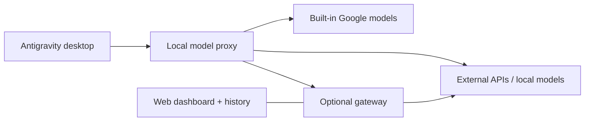

<p align="center">
  
</p>

<h1 align="center">Antigravity Custom Model Enabler</h1>

<p align="center">
  <strong>आपके प्रदाता। आपके स्थानीय मॉडल। Antigravity के अंदर।</strong><br>
  डेस्कटॉप ऐप, Antigravity IDE और वैकल्पिक गेटवे के लिए मॉडल प्रबंधन।
</p>

<p align="center">
  <a href="https://github.com/vahapogut/antigravity-add-model/actions/workflows/ci.yml"></a>
  <a href="#installation"></a>
  <a href="LICENSE"></a>
</p>

<p align="center">
  <a href="README.md">English</a> · <a href="README_zh.md">简体中文</a> · <a href="README_es.md">Español</a> · <a href="README_tr.md">Türkçe</a> · <a href="README_ru.md">Русский</a> · <strong>हिन्दी</strong> · <a href="README_ar.md">العربية</a>
</p>

<p align="center">
  <a href="#installation"><strong>जल्दी शुरू करें</strong></a> ·
  <a href="#quick-links">ज़रूरी लिंक</a> ·
  <a href="#screenshots">स्क्रीनशॉट</a> ·
  <a href="#documentation">दस्तावेज़</a> ·
  <a href="https://github.com/vahapogut/antigravity-add-model/issues/new">समस्या की सूचना दें</a>
</p>

---

Antigravity के अंतर्निहित मॉडलों के साथ बाहरी API प्रदाता और स्थानीय मॉडल जोड़ें। उन्हें Settings में कॉन्फ़िगर करें, चैट के मॉडल चयन मेन्यू से मॉडल बदलें और चाहें तो अनुरोधों को ऐसे गेटवे से भेजें जिसमें इतिहास, फ़ॉलबैक प्रदाता और ब्राउज़र डैशबोर्ड हो।

> [!IMPORTANT]
> **अलग Electron डेस्कटॉप एजेंट** नीचे दिए गए ऐड-ऑन इंस्टॉलर का उपयोग करता है। अलग **VS Code पर आधारित Antigravity IDE** के लिए अपना [सेटिंग्स अडैप्टर और स्थानीय वेब मैनेजर](docs/ide.md) है। Windows IDE **2.5.5** में साइन-इन, मूल मॉडल चयन और स्ट्रीमिंग चैट को स्थानीय OpenAI-संगत प्रदाता के साथ सत्यापित किया गया है; [सत्यापन परिणाम](docs/ide.md#validation-boundary) देखें। कस्टम मॉडल रूटिंग स्थानीय सत्रों पर लागू होती है; विक्रेता की WSL रूटिंग सुरक्षित रहती है। इंस्टॉल करने से पहले [संगतता](docs/compatibility.md) जाँचें।

इस README से जुड़े तकनीकी दस्तावेज़ अंग्रेज़ी में हैं। ऐप में विकल्प ढूँढना आसान हो, इसलिए उसके बटन और फ़ील्ड के नाम अंग्रेज़ी में ही रखे गए हैं।

<a id="quick-links"></a>

## ज़रूरी लिंक

| शुरुआत करें | कॉन्फ़िगर करें और कनेक्ट करें | सहायता और प्रोजेक्ट |
| --- | --- | --- |
| [इंस्टॉलेशन](#installation) | [गेटवे और वेब डैशबोर्ड](#optional-gateway-and-web-dashboard) | [समस्या निवारण और रिकवरी](#updates-diagnostics-and-recovery) |
| [अपना पहला मॉडल जोड़ें](#add-your-first-model) | [दूसरे कंप्यूटर से कनेक्ट करें](#connect-from-another-computer) | [समर्थित ऐप संस्करण और संरचनाएँ](docs/compatibility.md) |
| [प्रदाता और मॉडल कैटलॉग](docs/providers.md) | [मॉडल कॉन्फ़िगरेशन](docs/configuration.md) | [बदलावों का विवरण](CHANGELOG.md) |
| [विकास और योगदान](#development-and-contributing) | [Google खाता सेटअप](docs/configuration.md#google-cloud-code-account-pools) | [मौजूदा समस्याएँ देखें](https://github.com/vahapogut/antigravity-add-model/issues) |
| [Antigravity IDE सेटअप](docs/ide.md) | [स्रोत कोड पर आधारित सुविधाओं की तुलना](docs/feature-parity.md) | [IDE की स्थिति और पुनर्स्थापना](docs/ide.md#status-and-recovery) |
| [Cloudflare सेटअप विज़ार्ड](docs/workers-ai-setup.md) | [फ़ॉलबैक शृंखलाएँ](docs/providers.md#fallback-chains-for-rate-limited-providers) | [स्थानीय प्रॉक्सी की सुरक्षा](docs/compatibility.md#local-proxy-trust-boundary) |

<a id="what-you-can-do"></a>

## आप क्या कर सकते हैं

| सुविधा | क्या शामिल है |
| --- | --- |
| **मॉडल प्रबंधन** | प्रदाता के अनुसार समूह, खोज, संपादन, प्रतिलिपि बनाना, चालू/बंद करना और उपलब्ध मॉडल खोजना। |
| **अपने प्रदाताओं को जोड़ें** | OpenAI, Anthropic, Gemini, OpenRouter, [Cloudflare Workers AI](docs/providers.md#cloudflare-workers-ai) और अन्य संगत API; साथ ही Ollama, LM Studio और vLLM जैसी स्थानीय सेवाएँ। |
| **अनुरोधों को अनुकूलित करें** | प्रोटोकॉल का चयन, रीजनिंग सेटिंग्स, संदर्भ/आउटपुट सीमाएँ, कस्टम हेडर, टाइमआउट, दोबारा प्रयास, फ़ॉलबैक और सर्किट ब्रेकर। |
| **उप-एजेंट के मॉडल चुनें** | `invoke_subagent` वाले क्लाइंट अलग रूटिंग के साथ कस्टम चाइल्ड मॉडल का समर्थन करते हैं। Antigravity IDE [कस्टम मॉडल MCP टूल](docs/ide.md#delegate-to-custom-models-with-mcp) के माध्यम से स्वतंत्र टेक्स्ट कार्य सौंप सकता है। |
| **Google खातों का पूल उपयोग करें** | पहचाने गए IDE 2.5.5 इंस्टॉलेशन से [Antigravity खाते में साइन-इन](docs/configuration.md#google-cloud-code-account-pools), या अपने OAuth क्लाइंट का उपयोग; प्रोजेक्ट तैयार करना, एन्क्रिप्टेड स्टोरेज, कोटा जाँचना और परिस्थितियों के अनुसार खाता चयन। [वास्तविक साइन-इन, टोकन रिफ़्रेश और उत्तर बनाने के परिणाम](docs/configuration.md#verified-google-account-flow)। |
| **खाता कार्ड प्रबंधित करें** | पैनल समेटें, खाते चालू/बंद करें, लेबल बदलें, पूल से हटाएँ और Preferred/Automatic चुनें। हर पूल का प्रोजेक्ट और कोटा अलग रहता है; प्लान केवल प्रदाता की जानकारी से दिखता है। Native fallback केवल ठीक उसी मॉडल वाले Cloud Code पूल का उपयोग करता है, सार्वजनिक Gemini API का नहीं। [विवरण](docs/configuration.md#quota-panel-and-preferred-accounts)। |
| **दिखाई देने वाले संदर्भ का अनुमान** | पहचाने गए मूल मॉडल चयनकर्ता के पास केवल-पढ़ने वाला संकेतक अनुमान के लिए `~` और अनुपलब्ध उपयोग के लिए `?` दिखाता है। छिपे प्रॉम्प्ट, टूल परिभाषाएँ और चित्र शामिल नहीं हैं। कॉन्फ़िगर की गई सीमा पहले ली जाती है; क्लिक करने पर समय/आकार सीमा के साथ सार्वजनिक models.dev कैटलॉग से अनुपलब्ध सीमा खोजी जाती है, सेटिंग नहीं बदली जाती। [दायरा](docs/configuration.md#native-context-estimate)। |
| **सीधे भेजे गए अनुरोध जाँचें** | हाल के अनुरोधों, मापी गई देरी/टोकन खपत और उपयोगकर्ता द्वारा चलाए जाने वाले छोटे उत्तर-जनरेशन परीक्षण के साथ डायग्नोस्टिक्स। |
| **Antigravity IDE जोड़ें** | वापस हटाया जा सकने वाला सेटिंग्स अडैप्टर, प्रोजेक्ट के नियंत्रण में प्रॉक्सी लॉन्चर और ब्राउज़र मॉडल मैनेजर; Windows IDE 2.5.5 पर स्थानीय OpenAI-संगत प्रदाता के साथ मूल मॉडल चयन और स्ट्रीमिंग चैट सत्यापित हैं। [सेटअप](docs/ide.md)। |
| **मूल मॉडल चयन स्थिर रखें** | मॉडल उपनामों और effort विकल्पों के लिए स्थायी, आपस में न टकराने वाले ID, साथ ही स्पष्ट [मूल मॉडल चयन क्षमता](docs/ide.md#native-model-identities-and-capacity)। |
| **कॉन्फ़िगरेशन साझा करें** | सत्यापित JSON/base64 आयात और ऐसे निर्यात जिनमें सहेजी गई गुप्त जानकारी शामिल नहीं होती। |
| **वेब डैशबोर्ड जोड़ें** | प्रदाता रूटिंग, अनुरोध/सत्र इतिहास, रीप्ले, चार्ट और अनुमानित लागत वाला वैकल्पिक गेटवे। |
| **दूर से कनेक्ट करें** | टनल या कॉन्फ़िगर किए गए नेटवर्क एंडपॉइंट के माध्यम से प्रमाणित गेटवे एक्सेस। |

इंस्टॉलर इंस्टॉल किए गए ऐप के रनटाइम को सुरक्षित रखते हुए सत्यापित हुक जोड़ता है। यह हर संस्करण के लिए बैकअप रखता है और असफल डिप्लॉयमेंट को वापस करता है। कार्यान्वयन और दायरे के विवरण के लिए [सुविधाओं की तुलना](docs/feature-parity.md) देखें।

<a id="screenshots"></a>

## स्क्रीनशॉट

<a id="model-management"></a>

### मॉडल प्रबंधन

अपने मॉडल खोजें, उन्हें प्रदाता के अनुसार व्यवस्थित करें और एक ही जगह से कनेक्शन संपादित करें, उनकी प्रतिलिपि बनाएँ या उन्हें चालू करें।

<p align="center">
  <a href="assets/model_manager.jpg"></a>
</p>

*मौजूदा ऐड-ऑन के नियंत्रण एक अलग ब्राउज़र डेमो में उदाहरण मॉडल सेटिंग्स के साथ दिखाए गए हैं। तस्वीर को पूरे आकार में देखने के लिए उस पर क्लिक करें।*

<a id="model-editor"></a>

### मॉडल एडिटर

प्रदाता और मॉडल कॉन्फ़िगर करें, API फ़ॉर्मैट चुनें या उपलब्ध मॉडल खोजें।

<p align="center">
  <a href="assets/model_editor.jpg"></a>
</p>

<a id="remote-gateway"></a>

### रिमोट गेटवे

गेटवे कनेक्शन सहेजें, मॉडल उपनाम आयात करें और उसका प्रबंधन डैशबोर्ड खोलें।

<p align="center">
  <a href="assets/remote_gateway.jpg"></a>
</p>

<a id="gateway-dashboard"></a>

### गेटवे डैशबोर्ड

वैकल्पिक वेब पैनल में मॉडल उपनामों को प्रदाताओं से जोड़ें और फ़ॉलबैक मॉडल तथा संदर्भ सीमाएँ कॉन्फ़िगर करें।

<p align="center">
  <a href="assets/model_gateway.jpg"></a>
</p>

*स्थानीय परीक्षण प्रोफ़ाइल में वर्तमान गेटवे इंटरफ़ेस; दिखाई गई मॉडल मैपिंग केवल उदाहरण है।*

<details>
<summary><strong>डेस्कटॉप चैट का मॉडल चयन मेन्यू — पुराना बिल्ड</strong></summary>

<p align="center">
  
</p>

*पुराने डेस्कटॉप बिल्ड का उदाहरण। मॉडल के नाम और उनकी उपलब्धता आपके प्रदाता तथा कॉन्फ़िगरेशन पर निर्भर करती है।*

</details>

<a id="installation"></a>

## इंस्टॉलेशन

<a id="1-get-the-project-and-build"></a>

### 1. प्रोजेक्ट प्राप्त करें और बिल्ड बनाएँ

आपको **अलग Antigravity डेस्कटॉप ऐप**, Git और **Node.js 22.13 या नया संस्करण** चाहिए। Node का यह संस्करण डेस्कटॉप ऐड-ऑन और वैकल्पिक गेटवे दोनों के लिए उपयुक्त है।

```sh
git clone https://github.com/vahapogut/antigravity-add-model.git
cd antigravity-add-model
npm ci --ignore-scripts
npm run build
```

रिपॉज़िटरी पहले से मौजूद है? अपनी स्थानीय प्रति अपडेट करें, फिर निर्भरताएँ इंस्टॉल करने और बिल्ड बनाने के कमांड दोबारा चलाएँ।

**Antigravity IDE** उपयोग कर रहे हैं? नीचे दिए गए अलग डेस्कटॉप इंस्टॉलर के बजाय [IDE सेटअप](docs/ide.md) से आगे बढ़ें। उसकी मूल प्रक्रिया यह है:

```sh
npm run ide:check -- --resources "/path/to/Antigravity IDE/resources"
npm run ide:apply -- --resources "/path/to/Antigravity IDE/resources"
npm run proxy:start -- --open
npm run ide:launch -- --resources "/path/to/Antigravity IDE/resources"
```

<a id="2-check-and-patch-the-installed-app"></a>

### 2. इंस्टॉल किए गए ऐप की जाँच करें और पैच लगाएँ

पहले Antigravity और उसका लैंग्वेज सर्वर बंद करें। रिपॉज़िटरी की डायरेक्टरी से चलाएँ:

```sh
node scripts/deploy.mjs --check
node scripts/deploy.mjs
```

पहला कमांड इंस्टॉलेशन में कोई बदलाव किए बिना संगतता जाँचता है। दूसरा ऐड-ऑन लागू करता है। डिप्लॉयमेंट सफल होने के बाद Antigravity दोबारा खोलें।

अगर स्वचालित खोज आपका ऐप नहीं ढूँढ पाती, तो दोनों कमांड में एक ही स्पष्ट पथ दें:

```sh
node scripts/deploy.mjs --check --resources "/path/to/Antigravity/resources"
node scripts/deploy.mjs --resources "/path/to/Antigravity/resources"
```

`--resources` में Resources डायरेक्टरी, इंस्टॉलेशन डायरेक्टरी या macOS की `.app` डायरेक्टरी दी जा सकती है। अपरिचित संरचनाओं को ऐप की फ़ाइलें बदलने से पहले ही अस्वीकार कर दिया जाता है।

<details>
<summary><strong>प्लैटफ़ॉर्म रैपर और वैकल्पिक Windows एंडपॉइंट पैच</strong></summary>

ये रैपर उसी इंस्टॉलर को चलाते हैं और वही आर्ग्युमेंट स्वीकार करते हैं।

| प्लैटफ़ॉर्म | रैपर |
| --- | --- |
| Windows / PowerShell | `./deploy.ps1` |
| macOS का अलग ऐप | `bash deploy.sh` |
| Linux | `bash deploy_linux.sh` |

Windows के कुछ पहचाने गए लैंग्वेज-सर्वर बाइनरी, कॉन्फ़िगर किए जा सकने वाले मॉडल-सूची एंडपॉइंट को बायपास करते हैं। उन बिल्ड के लिए वैकल्पिक बाइनरी पैच जाँचें और लागू करें:

```powershell
.\deploy.ps1 --check --patch-language-server
.\deploy.ps1 --patch-language-server
```

इस विकल्प के लिए पोर्ट **50999** आवश्यक है और यह बैकअप/रोलबैक प्रक्रिया का हिस्सा है। यह केवल पहचाने गए Windows बाइनरी के लिए है। [Windows एंडपॉइंट पैचिंग](docs/compatibility.md#optional-windows-language-server-endpoint-patch) देखें।

</details>

<a id="add-your-first-model"></a>

## अपना पहला मॉडल जोड़ें

1. **Settings → Models & Usage** खोलें (पुरानी संरचनाओं में **Models**)।
2. **Custom Models** में **Add model** चुनें और प्रदाता चुनें।
3. जहाँ आवश्यक हो, **API URL** और **API key** भरें।
4. नीचे दिए गए किसी भी तरीके से मॉडल जोड़ें, फिर चैट चयन मेन्यू से सहेजा गया मॉडल चुनें।

| तरीका | चरण |
| --- | --- |
| **मॉडल मैन्युअल रूप से भरें** | सटीक **Provider model ID** भरें, चाहें तो दिखाने के लिए नाम दें, फिर **Test connection → Save model** चुनें। |
| **प्रदाता के कैटलॉग से चुनें** | **Fetch provider models** चुनें, नाम या ID से खोजें, मॉडल चुनें या **Select filtered** दबाएँ, फिर **Add selected** चुनें। |

**स्थानीय मॉडल चला रहे हैं?** पहले अपना स्थानीय सर्वर शुरू करें, फिर **Discover local** चुनें। सामान्य पोर्ट की खोज केवल आपके अनुरोध पर होती है।

**Cloudflare Workers AI उपयोग कर रहे हैं?** खाते का चयन, सीमित अनुमतियों वाला टोकन बनाना या मौजूदा टोकन उपयोग करना, और मॉडल चुनने के लिए `npm run workers-ai:setup -- wizard` चलाएँ। यह वैकल्पिक सहायक सहेजी गई गुप्त जानकारी को एन्क्रिप्ट करता है और किसी एक खाते की प्रविष्टियों को रोटेट कर सकता है। [सेटअप, अनुमतियाँ और सत्यापन की सीमाएँ](docs/workers-ai-setup.md) देखें।

**सेटिंग्स दूसरे कंप्यूटर पर ले जा रहे हैं?** **Export** और **Import** उपयोग करें। निर्यात किए गए कॉन्फ़िगरेशन में API कुंजियाँ, कस्टम हेडर और Google टोकन/क्लाइंट सीक्रेट शामिल नहीं होते; उन्हें प्राप्त करने वाले कंप्यूटर पर भरें।

> [!NOTE]
> सफल कनेक्शन परीक्षण मॉडल की सूची और प्रमाणीकरण की जाँच करता है। यह उत्तर नहीं बनाता और न ही साबित करता है कि खाते में उत्तर बनाने का कोटा है। जिन प्रदाताओं के पास सूची देने वाला एंडपॉइंट नहीं है, उन्हें भी मैन्युअल रूप से कॉन्फ़िगर किया जा सकता है।

<a id="providers-and-advanced-options"></a>

### प्रदाता और उन्नत विकल्प

| कनेक्शन | प्रीसेट कैटलॉग में उपलब्ध उदाहरण |
| --- | --- |
| कई मॉडल देने वाली सेवाएँ | OpenRouter, Together AI, Hugging Face Inference Providers, Fireworks AI, SiliconFlow, Novita AI |
| सीधे होस्ट किए गए API | OpenAI, Anthropic, Google Gemini, DeepSeek, Groq, Mistral, xAI, Cerebras, SambaNova, Alibaba Cloud Model Studio, NVIDIA NIM |
| स्थानीय सर्वर | Ollama, LM Studio, llama.cpp, vLLM, LocalAI, TabbyAPI, Text Generation WebUI |
| अन्य एंडपॉइंट | LiteLLM, संगत कस्टम एंडपॉइंट या प्रमाणित मॉडल गेटवे |

प्रीसेट डिफ़ॉल्ट मान भरते हैं; **API format** तय करता है कि अनुरोधों को कैसे बदला जाए। मॉडल ID और एक्सेस प्रदाता पर निर्भर करते हैं। पूरी सूची [प्रदाता कैटलॉग](src/providers.ts) में है।

**सैकड़ों मॉडल के विकल्प चाहिए?** OpenRouter और अन्य बहु-मॉडल सेवाएँ **Fetch provider models** से वर्तमान कैटलॉग देती हैं। ज़रूरत के मॉडल खोजकर चुनें; ऐड-ऑन आपके स्पष्ट ओवरराइड बनाए रखते हुए उपलब्ध संदर्भ/आउटपुट सीमाएँ और इमेज/रीजनिंग मेटाडेटा आयात करता है। कैटलॉग समय के साथ बदलते हैं और सूची में होने पर भी मॉडल के लिए खाते का एक्सेस तथा आपके कार्य की ज़रूरी क्षमताएँ चाहिए। [प्रदाता सेटअप और मॉडल खोज](docs/providers.md) देखें।

**तस्वीरें समझने वाला मॉडल उपयोग कर रहे हैं?** डेस्कटॉप प्रॉक्सी इमेज इनपुट को OpenAI-संगत और Anthropic-संगत एंडपॉइंट तक भेजता है, जिनमें संगत DeepSeek विज़न मॉडल भी शामिल हैं। क्षमता ओवरराइड, समर्थित फ़ॉर्मैट और एंडपॉइंट की आवश्यकताओं के लिए [इमेज इनपुट सेटअप](docs/configuration.md#image-inputs) देखें।

अनुरोध सीमाओं, रीजनिंग, हेडर, फ़ॉलबैक मॉडल और अन्य ओवरराइड के लिए **Advanced settings** खोलें। फ़ील्ड की परिभाषाओं और आयात उदाहरण के लिए [कॉन्फ़िगरेशन संदर्भ](docs/configuration.md) देखें।

Google खातों के पूल के लिए **Google Cloud Code account pool** चुनें और [खाता सेटअप गाइड](docs/configuration.md#google-cloud-code-account-pools) का पालन करें। पहचाने गए IDE **2.5.5** इंस्टॉलेशन के साथ **Antigravity account** से साइन-इन करें, या अपना क्लाइंट उपयोग करने के लिए **My Desktop OAuth client** चुनें। खाते और सेवा की पात्रता प्रदाता के नियंत्रण में रहती है।

<a id="optional-gateway-and-web-dashboard"></a>

## वैकल्पिक गेटवे और वेब डैशबोर्ड

डेस्कटॉप ऐड-ऑन सीधे आपके प्रदाताओं से जुड़ सकता है। केंद्रीकृत रूटिंग, ब्राउज़र से प्रबंधन, अनुरोध इतिहास या रिमोट एंडपॉइंट चाहिए तो गेटवे जोड़ें।

```sh
npm run gateway:install
npm run gateway:build
npm run gateway -- setup --non-interactive
npm run gateway -- start
```

सेटअप बनाए गए गेटवे टोकन और डैशबोर्ड लॉगिन की जानकारी स्थानीय रूप से दिखाता है। **http://127.0.0.1:51001** खोलें, साइन-इन करें, प्रदाता की गुप्त जानकारी और मॉडल उपनाम कॉन्फ़िगर करें, फिर सहेजें।

डेस्कटॉप के **Remote gateway** संवाद में भरें:

| फ़ील्ड | स्थानीय सेटअप |
| --- | --- |
| Gateway URL | `http://127.0.0.1:51000` |
| Gateway token | सेटअप में दिखाया गया टोकन |
| Dashboard URL | `http://127.0.0.1:51001` |

**Test gateway** चुनें, फिर **Import model aliases** चुनें। आयात किए गए मॉडल डेस्कटॉप के चयन मेन्यू में दिखते हैं। **Open dashboard** सहेजा गया डैशबोर्ड URL खोलता है।

<details>
<summary><strong>गेटवे कमांड</strong></summary>

```sh
npm run gateway -- status
npm run gateway -- logs
npm run gateway -- stop
```

डैशबोर्ड में सहेजे गए प्रदाता/मॉडल के बदलाव तुरंत दोबारा लोड हो जाते हैं। सुनने वाले पते और पोर्ट में बदलाव के लिए रीस्टार्ट आवश्यक है। इतिहास में प्रॉम्प्ट, उत्तर और टूल आर्ग्युमेंट शामिल होते हैं; कुल लागत अनुमानित होती है।

</details>

<a id="connect-from-another-computer"></a>

### दूसरे कंप्यूटर से कनेक्ट करें

गेटवे उस होस्ट पर चलाएँ जहाँ से आपके प्रदाताओं तक एक्सेस हो। क्लाइंट पर दोनों पोर्ट SSH से फ़ॉरवर्ड करें:

```sh
ssh -N -L 51000:127.0.0.1:51000 -L 51001:127.0.0.1:51001 user@gateway-host
```

टनल खुली रखें और ऊपर की तालिका वाले स्थानीय URL उपयोग करें। दोनों गेटवे लिसनर डिफ़ॉल्ट रूप से लूपबैक से बाइंड होते हैं। स्पष्ट नेटवर्क लिसनर या HTTPS रिवर्स प्रॉक्सी के लिए [रिमोट एक्सेस गाइड](gateway/README.md#remote-access) देखें।

<a id="how-it-fits-together"></a>

## यह सब कैसे जुड़ता है



ऐड-ऑन अपने Settings नियंत्रण जोड़ता है और इंस्टॉल किए गए विक्रेता रनटाइम को सुरक्षित रखता है। गेटवे एक अलग Node प्रक्रिया के रूप में चलता है और अपनी डेटा डायरेक्टरी उपयोग करता है।

<a id="updates-diagnostics-and-recovery"></a>

## अपडेट, डायग्नोस्टिक्स और रिकवरी

Antigravity अपडेट होने के बाद ऐड-ऑन का बिल्ड फिर बनाएँ और दोबारा डिप्लॉय करने से पहले संगतता की जाँच करें।

| ज़रूरत | कमांड |
| --- | --- |
| बिल्ड, मॉडल कॉन्फ़िगरेशन और स्थानीय सेवाएँ जाँचें | `npm run doctor` |
| डायग्नोस्टिक्स JSON में पाएँ | `npm run doctor -- --json` |
| किसी विशेष इंस्टॉलेशन की जाँच करें | `npm run patch:check -- --resources "/path/to/Resources"` |
| समर्थित इंस्टॉलेशन पर ऐड-ऑन दोबारा लागू करें | `npm run doctor:repair -- --resources "/path/to/Resources"` |
| इस इंस्टॉलर का बैकअप पुनर्स्थापित करें | `npm run patch:restore -- --resources "/path/to/Resources"` |

मरम्मत या पुनर्स्थापना से पहले ऐप बंद करें। जहाँ लागू हो, Windows एंडपॉइंट विकल्प उपयोग करें। अगर बाद के अपस्ट्रीम अपडेट ने इंस्टॉलेशन बदल दिया है, तो पुनर्स्थापना उसे ओवरराइट करने से मना कर देती है।

| लक्षण | शुरुआत यहाँ से करें |
| --- | --- |
| इंस्टॉलर `NOT_SUPPORTED` या `UNSUPPORTED_RUNTIME` दिखाता है | पुष्टि करें कि आपके पास अलग डेस्कटॉप ऐप है और [समर्थित संरचनाएँ](docs/compatibility.md) जाँचें। |
| ऐप अपडेट के बाद काली स्क्रीन | [स्टार्टअप रिकवरी](docs/compatibility.md#black-screen-after-an-update) का पालन करें; बिना जाँचे किसी पुराने आर्काइव को पुनर्स्थापित न करें। |
| मॉडल दिखाई नहीं दे रहा | जाँचें कि वह चालू है, सहेजा गया है और सही प्रदाता मॉडल ID उपयोग कर रहा है। |
| प्रदाता 401, 403 या 404 लौटाता है | गुप्त जानकारी, खाते के एक्सेस/स्थान, API URL और मॉडल की उपलब्धता जाँचें। |
| पोर्ट 50999 उपयोग में है | बाइनरी पैच वाले Windows इंस्टॉलेशन को वही निश्चित पोर्ट चाहिए; सामान्य, बिना पैच वाला संचालन दूसरा पोर्ट चुन सकता है। |
| TLS कनेक्शन असफल होता है | एंडपॉइंट का प्रमाणपत्र और अपने विश्वसनीय CA की सेटिंग्स जाँचें। |

अधिक जानकारी: [संगतता और रिकवरी](docs/compatibility.md) · [मॉडल कॉन्फ़िगरेशन](docs/configuration.md)

<a id="credentials-and-data"></a>

## गुप्त जानकारी और डेटा

| घटक | सहेजा गया डेटा और व्यवहार |
| --- | --- |
| डेस्कटॉप ऐड-ऑन | मॉडल `~/.gemini/antigravity/custom_models.json` में रहते हैं। सहेजी गई API कुंजियाँ, हेडर, गेटवे टोकन और Google की गुप्त जानकारी एन्क्रिप्ट की जाती है और एडिटर में छिपाकर दिखाई जाती है। |
| एन्क्रिप्शन का वैकल्पिक तरीका | जब ऑपरेटिंग सिस्टम का सुरक्षित स्टोरेज उपलब्ध न हो, स्थानीय AES-256-GCM `~/.gemini/antigravity/.model-credentials-key` का उपयोग करता है। इस कुंजी को निजी बैकअप के साथ सुरक्षित रखें। |
| मॉडल निर्यात | सहेजी गई API कुंजियाँ, कस्टम हेडर और Google टोकन/क्लाइंट सीक्रेट शामिल नहीं होते। सामान्य कॉन्फ़िगरेशन फ़ील्ड रखे जाते हैं। |
| वैकल्पिक गेटवे | अपनी `~/.gemini/antigravity/gateway` प्रोफ़ाइल उपयोग करता है। इसकी गुप्त जानकारी का कॉन्फ़िगरेशन Electron स्टोरेज से अलग है; इतिहास में अनुरोध और उत्तर की सामग्री होती है। |

मॉडल सेटिंग्स साझा करने के लिए **Export** उपयोग करें। स्थानीय प्रोफ़ाइल कॉपी करने से पहले [डेटा प्रबंधन](docs/configuration.md#credentials-and-data) और [गेटवे स्टोरेज](gateway/README.md#lifecycle-and-data) देखें।

<a id="documentation"></a>

## दस्तावेज़

नीचे दिए गए विस्तृत गाइड अंग्रेज़ी में उपलब्ध हैं।

| गाइड | विषय |
| --- | --- |
| [कॉन्फ़िगरेशन संदर्भ](docs/configuration.md) | मॉडल फ़ील्ड, आयात फ़ॉर्मैट, Google खाते और गुप्त जानकारी |
| [प्रदाता और मॉडल कैटलॉग](docs/providers.md) | लोकप्रिय सेवाएँ, API एंडपॉइंट, बड़े कैटलॉग में मॉडल खोजना और खाते की आवश्यकताएँ |
| [Cloudflare सेटअप विज़ार्ड](docs/workers-ai-setup.md) | खाता चयन, सीमित अनुमतियों वाले टोकन, एन्क्रिप्टेड मॉडल आयात और किसी एक खाते के लिए रोटेशन |
| [गेटवे गाइड](gateway/README.md) | सेटअप, रूटिंग, डैशबोर्ड, जीवनचक्र और रिमोट एक्सेस |
| [संगतता और रिकवरी](docs/compatibility.md) | समर्थित संरचनाएँ, अपडेट, बैकअप और समस्या निवारण |
| [सुविधाओं की तुलना](docs/feature-parity.md) | संदर्भ रिपॉज़िटरी, लागू की गई सुविधाएँ और बाकी अंतर |
| [बदलावों का विवरण](CHANGELOG.md) | वर्तमान बदलाव और पुराने रिलीज़ नोट |
| [गेटवे का स्रोत और श्रेय](gateway/UPSTREAM.md) | स्रोत का संस्करण और सुरक्षित रखी गई लाइसेंस सूचनाएँ |

<a id="development-and-contributing"></a>

## विकास और योगदान

डेस्कटॉप ऐड-ऑन `src/` में TypeScript के रूप में है और उसका संकलित आउटपुट Git में रखी गई `dist/` डायरेक्टरी में जाता है। वैकल्पिक गेटवे का अपना पैकेज `gateway/` में है।

```sh
npm ci --ignore-scripts
npm run build
npm test
npm run lint
```

गेटवे या इंटीग्रेशन में बदलाव के लिए:

```sh
npm run gateway:install
npm run gateway:build
npm run gateway:test
npm run test:integration
```

CI स्थानीय प्रदाता फ़िक्स्चर और अलग किए गए इंस्टॉलेशन पैकेज के साथ Windows, macOS और Linux पर चलता है। यह वास्तविक प्रदाता की गुप्त जानकारी या Antigravity के भविष्य के हर संस्करण का सत्यापन नहीं करता।

नए प्रदाता के लिए [डेस्कटॉप प्रीसेट कैटलॉग](src/providers.ts), [प्रोटोकॉल रजिस्ट्री](src/proxy/registry.ts) और [गेटवे प्रदाता कैटलॉग](gateway/src/provider-catalog.ts) से शुरू करें। बदलावों में प्रासंगिक परीक्षण और दोबारा बनाया गया डेस्कटॉप आउटपुट शामिल होना चाहिए। पुल रिक्वेस्ट का स्वागत है; दोहराई जा सकने वाली समस्याओं के लिए अपने ऐप के प्रकार/संस्करण, OS और डायग्नोस्टिक्स के साथ [इश्यू खोलें](https://github.com/vahapogut/antigravity-add-model/issues)।

<a id="license-and-credits"></a>

## लाइसेंस और श्रेय

[Apache License 2.0](LICENSE)। अनुकूलित गेटवे घटकों के [MIT लाइसेंस](gateway/LICENSE.upstream) और [मूल स्रोत का श्रेय](gateway/UPSTREAM.md) सुरक्षित रखे गए हैं।

Antigravity का लोगो [Google की आधिकारिक प्रेस सामग्री](https://antigravity.google/press) से लिया गया है।

रखरखाव: **[vahapogut](https://github.com/vahapogut)** · [LinkedIn](https://www.linkedin.com/in/abdulvahap-ogut-343992398/)

<p align="center"><a href="#quick-links">↑ ज़रूरी लिंक पर वापस जाएँ</a></p>
