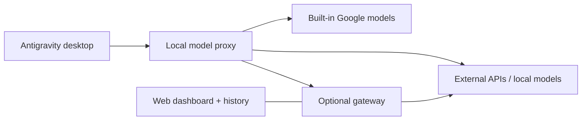

<p align="center">
  
</p>

<h1 align="center">Antigravity Custom Model Enabler</h1>

<p align="center">
  <strong>Ваши провайдеры. Ваши локальные модели. Внутри Antigravity.</strong><br>
  Управление моделями в настольном приложении, Antigravity IDE и через необязательный шлюз.
</p>

<p align="center">
  <a href="https://github.com/vahapogut/antigravity-add-model/actions/workflows/ci.yml"></a>
  <a href="#installation"></a>
  <a href="LICENSE"></a>
</p>

<p align="center">
  <a href="README.md">English</a> · <a href="README_zh.md">简体中文</a> · <a href="README_es.md">Español</a> · <a href="README_tr.md">Türkçe</a> · <strong>Русский</strong> · <a href="README_hi.md">हिन्दी</a> · <a href="README_ar.md">العربية</a>
</p>

<p align="center">
  <a href="#installation"><strong>Быстрый старт</strong></a> ·
  <a href="#quick-links">Быстрые ссылки</a> ·
  <a href="#screenshots">Скриншоты</a> ·
  <a href="#documentation">Документация</a> ·
  <a href="https://github.com/vahapogut/antigravity-add-model/issues/new">Сообщить о проблеме</a>
</p>

---

Добавляйте внешние API и локальные модели рядом со встроенными моделями Antigravity. Настраивайте их в Settings, переключайтесь между ними в списке моделей чата и при необходимости направляйте запросы через шлюз с историей, резервными провайдерами и веб-панелью управления.

> [!IMPORTANT]
> Для **отдельного настольного агента на Electron** предназначен установщик дополнения, описанный ниже. Другая программа — **Antigravity IDE на основе VS Code** — использует собственные [адаптер настроек и локальный веб-менеджер](docs/ide.md). В Windows IDE **2.5.5** проверены вход в систему, выбор модели во встроенном списке и потоковый чат с локальным OpenAI-совместимым провайдером; см. [результаты проверки](docs/ide.md#validation-boundary). Маршрутизация пользовательских моделей действует для локальных сеансов; маршрутизация WSL, предусмотренная разработчиком IDE, сохраняется. Перед установкой ознакомьтесь с [совместимостью](docs/compatibility.md).

Связанные технические руководства пока доступны на английском языке. Названия элементов интерфейса ниже сохранены на английском, чтобы их было проще найти в приложении.

<a id="quick-links"></a>

## Быстрые ссылки

| Начало работы | Настройка и подключение | Помощь и проект |
| --- | --- | --- |
| [Установка](#installation) | [Шлюз и веб-панель](#optional-gateway-and-web-dashboard) | [Диагностика и восстановление](#updates-diagnostics-and-recovery) |
| [Добавление первой модели](#add-your-first-model) | [Подключение с другого компьютера](#connect-from-another-computer) | [Поддерживаемые версии и структура приложения](docs/compatibility.md) |
| [Провайдеры и каталоги моделей](docs/providers.md) | [Настройка моделей](docs/configuration.md) | [История изменений](CHANGELOG.md) |
| [Разработка и участие в проекте](#development-and-contributing) | [Настройка аккаунтов Google](docs/configuration.md#google-cloud-code-account-pools) | [Существующие обращения](https://github.com/vahapogut/antigravity-add-model/issues) |
| [Настройка Antigravity IDE](docs/ide.md) | [Сравнение возможностей по исходному коду](docs/feature-parity.md) | [Состояние IDE и восстановление](docs/ide.md#status-and-recovery) |
| [Мастер настройки Cloudflare](docs/workers-ai-setup.md) | [Цепочки резервных моделей](docs/providers.md#fallback-chains-for-rate-limited-providers) | [Безопасность локального прокси](docs/compatibility.md#local-proxy-trust-boundary) |

<a id="what-you-can-do"></a>

## Возможности

| Возможность | Что входит |
| --- | --- |
| **Управление моделями** | Группировка по провайдеру, поиск, редактирование, дублирование, включение и отключение, получение списка доступных моделей. |
| **Подключение провайдеров** | OpenAI, Anthropic, Gemini, OpenRouter, [Cloudflare Workers AI](docs/providers.md#cloudflare-workers-ai) и другие совместимые API; локальные сервисы, например Ollama, LM Studio и vLLM. |
| **Настройка запросов** | Выбор протокола, параметры рассуждения, ограничения контекста и ответа, собственные заголовки, тайм-ауты, повторные попытки, резервные модели и временное отключение провайдеров после сбоев. |
| **Выбор моделей для субагентов** | Клиенты с поддержкой `invoke_subagent` могут использовать пользовательские модели для дочерних агентов с изолированной маршрутизацией. Antigravity IDE может передавать независимые текстовые задачи через [MCP-инструменты для пользовательских моделей](docs/ide.md#delegate-to-custom-models-with-mcp). |
| **Пулы аккаунтов Google** | [Вход через аккаунт Antigravity](docs/configuration.md#google-cloud-code-account-pools) с использованием распознанной установки IDE 2.5.5 либо собственного OAuth-клиента; подготовка проекта, зашифрованное хранение, проверка квот и адаптивный выбор аккаунта. [Результаты проверки реального входа, обновления токенов и генерации](docs/configuration.md#verified-google-account-flow). |
| **Карточки аккаунтов** | Сворачиваемая панель, включение/отключение, изменение подписи, удаление из пулов и Preferred/Automatic. Проекты и квоты каждого пула остаются раздельными; тариф показывается только по данным провайдера. Переключатель native fallback использует только пул Cloud Code с точным совпадением модели, без перехода к публичному Gemini API. [Подробнее](docs/configuration.md#quota-panel-and-preferred-accounts). |
| **Оценка видимого контекста** | Индикатор рядом с распознанным встроенным выбором модели показывает оценку `~` или `?`, если данные недоступны. Скрытые промпты, определения инструментов и изображения не учитываются. Настроенный лимит имеет приоритет; щелчок запрашивает недостающий лимит в публичном каталоге models.dev с ограничениями времени и размера, не изменяя настройки. [Границы оценки](docs/configuration.md#native-context-estimate). |
| **Проверка прямых запросов** | Диагностика с последними запросами, измеренной задержкой и расходом токенов, а также отдельный небольшой тест генерации, запускаемый явно. |
| **Подключение Antigravity IDE** | Обратимый адаптер настроек, управляемый проектом запуск прокси и браузерный менеджер моделей; встроенный выбор модели и потоковый чат проверены в Windows IDE 2.5.5 с локальным OpenAI-совместимым провайдером. [Настройка](docs/ide.md). |
| **Стабильный выбор моделей во встроенном списке** | Постоянные уникальные идентификаторы для псевдонимов моделей и вариантов уровня рассуждения, с явно описанным [ограничением вместимости встроенного списка](docs/ide.md#native-model-identities-and-capacity). |
| **Обмен настройками** | Проверяемый импорт JSON/base64 и экспорт без сохранённых учётных данных. |
| **Веб-панель управления** | Необязательный шлюз с маршрутизацией между провайдерами, историей запросов и сеансов, повторным выполнением запросов, графиками и оценкой стоимости. |
| **Удалённое подключение** | Доступ к шлюзу с аутентификацией через туннель или настроенную сетевую конечную точку. |

Установщик сохраняет среду выполнения установленного приложения и добавляет проверенные точки подключения. Он создаёт резервные копии для конкретных версий и откатывает неудачные развёртывания. Подробности реализации и границы возможностей описаны в [сравнении функций](docs/feature-parity.md).

<a id="screenshots"></a>

## Скриншоты

<a id="model-management"></a>

### Управление моделями

Ищите модели, группируйте их по провайдеру, редактируйте, дублируйте или включайте подключения в одном месте.

<p align="center">
  <a href="assets/model_manager.jpg"></a>
</p>

*Текущие элементы управления дополнением показаны в изолированной браузерной демонстрации с примерными настройками моделей. Нажмите на изображение, чтобы открыть его в полном размере.*

<a id="model-editor"></a>

### Редактор модели

Настройте провайдера и модель, выберите формат API или получите список доступных моделей.

<p align="center">
  <a href="assets/model_editor.jpg"></a>
</p>

<a id="remote-gateway"></a>

### Удалённый шлюз

Сохраните подключение к шлюзу, импортируйте псевдонимы моделей и откройте его панель управления.

<p align="center">
  <a href="assets/remote_gateway.jpg"></a>
</p>

<a id="gateway-dashboard"></a>

### Панель управления шлюзом

В необязательной веб-панели сопоставляйте псевдонимы моделей с провайдерами, задавайте резервные модели и ограничения контекста.

<p align="center">
  <a href="assets/model_gateway.jpg"></a>
</p>

*Текущий интерфейс шлюза в локальном тестовом профиле; показанное сопоставление моделей приведено для примера.*

<details>
<summary><strong>Список моделей в настольном чате — более ранняя сборка</strong></summary>

<p align="center">
  
</p>

*Пример из более ранней настольной сборки. Названия и доступность моделей зависят от провайдера и ваших настроек.*

</details>

<a id="installation"></a>

## Установка

<a id="1-get-the-project-and-build"></a>

### 1. Скачайте проект и соберите его

Вам понадобятся **отдельное настольное приложение Antigravity**, Git и **Node.js 22.13 или новее**. Эта версия Node подходит и для настольного дополнения, и для необязательного шлюза.

```sh
git clone https://github.com/vahapogut/antigravity-add-model.git
cd antigravity-add-model
npm ci --ignore-scripts
npm run build
```

Репозиторий уже склонирован? Обновите локальную копию, затем снова выполните команды установки зависимостей и сборки.

Используете **Antigravity IDE**? Перейдите к [настройке IDE](docs/ide.md) вместо описанного ниже установщика для отдельного настольного приложения. Основная последовательность:

```sh
npm run ide:check -- --resources "/path/to/Antigravity IDE/resources"
npm run ide:apply -- --resources "/path/to/Antigravity IDE/resources"
npm run proxy:start -- --open
npm run ide:launch -- --resources "/path/to/Antigravity IDE/resources"
```

<a id="2-check-and-patch-the-installed-app"></a>

### 2. Проверьте установленное приложение и примените дополнение

Сначала закройте Antigravity и его языковой сервер. В каталоге репозитория выполните:

```sh
node scripts/deploy.mjs --check
node scripts/deploy.mjs
```

Первая команда проверяет совместимость, не изменяя установку. Вторая применяет дополнение. После успешного развёртывания снова откройте Antigravity.

Если автоматическое обнаружение не находит приложение, укажите один и тот же путь в обеих командах:

```sh
node scripts/deploy.mjs --check --resources "/path/to/Antigravity/resources"
node scripts/deploy.mjs --resources "/path/to/Antigravity/resources"
```

Параметр `--resources` принимает каталог Resources, каталог установки или каталог `.app` в macOS. Неизвестная структура установки отклоняется до замены файлов приложения.

<details>
<summary><strong>Скрипты для разных платформ и необязательный патч конечной точки в Windows</strong></summary>

Эти скрипты вызывают тот же установщик и принимают те же аргументы.

| Платформа | Скрипт |
| --- | --- |
| Windows / PowerShell | `./deploy.ps1` |
| Отдельное приложение для macOS | `bash deploy.sh` |
| Linux | `bash deploy_linux.sh` |

Некоторые распознаваемые бинарные файлы языкового сервера Windows обходят настраиваемую конечную точку списка моделей. Для таких сборок проверьте и примените необязательный бинарный патч:

```powershell
.\deploy.ps1 --check --patch-language-server
.\deploy.ps1 --patch-language-server
```

Для этого варианта нужен порт **50999**; изменения включены в механизм резервного копирования и отката. Он предназначен только для распознаваемых бинарных файлов Windows. См. [патч конечной точки в Windows](docs/compatibility.md#optional-windows-language-server-endpoint-patch).

</details>

<a id="add-your-first-model"></a>

## Добавление первой модели

1. Откройте **Settings → Models & Usage** (в старых версиях интерфейса — **Models**).
2. В разделе **Custom Models** нажмите **Add model** и выберите провайдера.
3. При необходимости укажите **API URL** и **API key**.
4. Добавьте модели одним из способов ниже, затем выберите сохранённую модель в списке моделей чата.

| Способ | Действия |
| --- | --- |
| **Ввести модель вручную** | Укажите точный **Provider model ID**, при желании задайте отображаемое имя, затем выберите **Test connection → Save model**. |
| **Выбрать из каталога провайдера** | Нажмите **Fetch provider models**, найдите модели по имени или идентификатору, отметьте нужные либо нажмите **Select filtered**, затем **Add selected**. |

**Запускаете модели локально?** Сначала запустите локальный сервер, затем выберите **Discover local**. Проверка распространённых портов выполняется только по вашему запросу.

**Используете Cloudflare Workers AI?** Запустите `npm run workers-ai:setup -- wizard`: мастер поможет выбрать аккаунт, создать токен с ограниченными правами или использовать существующий, а затем выбрать модели. Необязательный помощник шифрует сохранённые учётные данные и позволяет обновлять токены для записей одного аккаунта. См. [настройку, разрешения и границы проверки](docs/workers-ai-setup.md).

**Переносите настройки между компьютерами?** Используйте **Export** и **Import**. Экспортируемые настройки не содержат API-ключей, собственных заголовков, токенов Google и секретов OAuth-клиентов; введите учётные данные на принимающем компьютере.

> [!NOTE]
> Успешная проверка подключения подтверждает получение списка моделей и аутентификацию. Она не генерирует ответ и не доказывает наличие квоты на генерацию у аккаунта. Провайдеров без конечной точки списка моделей всё равно можно настроить вручную.

<a id="providers-and-advanced-options"></a>

### Провайдеры и расширенные настройки

| Тип подключения | Примеры из каталога предустановок |
| --- | --- |
| Сервисы с большим выбором моделей | OpenRouter, Together AI, Hugging Face Inference Providers, Fireworks AI, SiliconFlow, Novita AI |
| Прямые облачные API | OpenAI, Anthropic, Google Gemini, DeepSeek, Groq, Mistral, xAI, Cerebras, SambaNova, Alibaba Cloud Model Studio, NVIDIA NIM |
| Локальные серверы | Ollama, LM Studio, llama.cpp, vLLM, LocalAI, TabbyAPI, Text Generation WebUI |
| Другие конечные точки | LiteLLM, совместимые пользовательские конечные точки или шлюз моделей с аутентификацией |

Предустановки заполняют значения по умолчанию; параметр **API format** определяет преобразование запросов. Идентификаторы моделей и доступ к ним зависят от провайдера. Полный список находится в [каталоге провайдеров](src/providers.ts).

**Нужен выбор из сотен моделей?** OpenRouter и другие сервисы с большим выбором моделей предоставляют актуальные каталоги через **Fetch provider models**. Найдите и выберите нужные модели; дополнение импортирует доступные ограничения контекста и ответа, а также сведения о поддержке изображений и рассуждений, сохраняя явно заданные вами значения. Каталоги со временем меняются, а наличие модели в списке всё равно требует доступа со стороны аккаунта и поддержки возможностей, необходимых для вашей задачи. См. [настройку провайдеров и поиск моделей](docs/providers.md).

**Используете модель с поддержкой изображений?** Настольный прокси передаёт изображения конечным точкам, совместимым с OpenAI и Anthropic, в том числе совместимым моделям DeepSeek с поддержкой изображений. В [руководстве по настройке входных изображений](docs/configuration.md#image-inputs) описаны переопределение возможностей модели, поддерживаемые форматы и требования к конечным точкам.

Откройте **Advanced settings**, чтобы настроить ограничения запросов, рассуждения, заголовки, резервные модели и другие параметры. Определения полей и пример импорта приведены в [справочнике настроек](docs/configuration.md).

Для пула аккаунтов Google выберите **Google Cloud Code account pool** и следуйте [руководству по настройке аккаунтов](docs/configuration.md#google-cloud-code-account-pools). Войдите через **Antigravity account**, используя распознанную установку IDE **2.5.5**, или выберите **My Desktop OAuth client**, чтобы использовать собственный клиент. Провайдер по-прежнему определяет доступность аккаунтов и сервисов.

<a id="optional-gateway-and-web-dashboard"></a>

## Необязательный шлюз и веб-панель

Настольное дополнение может подключаться к провайдерам напрямую. Добавьте шлюз, если вам нужны централизованная маршрутизация, управление из браузера, история запросов или удалённая конечная точка.

```sh
npm run gateway:install
npm run gateway:build
npm run gateway -- setup --non-interactive
npm run gateway -- start
```

При настройке сгенерированный токен шлюза и данные входа в панель выводятся локально. Откройте **http://127.0.0.1:51001**, войдите, настройте учётные данные провайдеров и псевдонимы моделей, затем сохраните изменения.

В диалоге **Remote gateway** настольного приложения укажите:

| Поле | Локальная настройка |
| --- | --- |
| Gateway URL | `http://127.0.0.1:51000` |
| Gateway token | Токен, выведенный при настройке |
| Dashboard URL | `http://127.0.0.1:51001` |

Нажмите **Test gateway**, затем **Import model aliases**. Импортированные модели появятся в списке моделей настольного приложения. Кнопка **Open dashboard** открывает сохранённый URL панели управления.

<details>
<summary><strong>Команды шлюза</strong></summary>

```sh
npm run gateway -- status
npm run gateway -- logs
npm run gateway -- stop
```

Изменения провайдеров и моделей, сохранённые в панели, применяются сразу. Изменение адреса или порта прослушивания требует перезапуска. История содержит запросы, ответы и аргументы инструментов; общая стоимость является оценочной.

</details>

<a id="connect-from-another-computer"></a>

### Подключение с другого компьютера

Запустите шлюз на компьютере, имеющем доступ к вашим провайдерам. На клиенте пробросьте оба порта через SSH:

```sh
ssh -N -L 51000:127.0.0.1:51000 -L 51001:127.0.0.1:51001 user@gateway-host
```

Оставьте туннель открытым и используйте локальные URL из таблицы выше. По умолчанию оба сервиса шлюза принимают подключения только через loopback. Настройка явного сетевого адреса прослушивания или обратного прокси с HTTPS описана в [руководстве по удалённому доступу](gateway/README.md#remote-access).

<a id="how-it-fits-together"></a>

## Как всё связано



Дополнение добавляет свои элементы в Settings и сохраняет установленную среду выполнения разработчика приложения. Шлюз работает как отдельный процесс Node и использует собственный каталог данных.

<a id="updates-diagnostics-and-recovery"></a>

## Обновления, диагностика и восстановление

После обновления Antigravity заново соберите дополнение и повторите проверку совместимости перед повторным развёртыванием.

| Задача | Команда |
| --- | --- |
| Проверить сборку, настройки моделей и локальные сервисы | `npm run doctor` |
| Получить диагностику в JSON | `npm run doctor -- --json` |
| Проверить конкретную установку | `npm run patch:check -- --resources "/path/to/Resources"` |
| Повторно применить дополнение к поддерживаемой установке | `npm run doctor:repair -- --resources "/path/to/Resources"` |
| Восстановить резервную копию, созданную этим установщиком | `npm run patch:restore -- --resources "/path/to/Resources"` |

Закройте приложение перед исправлением или восстановлением. Используйте параметр патча конечной точки Windows, если он применим. Восстановление откажется перезаписывать установку, изменённую более поздним обновлением разработчика приложения.

| Симптом | С чего начать |
| --- | --- |
| Установщик сообщает `NOT_SUPPORTED` или `UNSUPPORTED_RUNTIME` | Убедитесь, что используете отдельное настольное приложение, и проверьте [поддерживаемую структуру установки](docs/compatibility.md). |
| Чёрный экран после обновления приложения | Следуйте [инструкции по восстановлению запуска](docs/compatibility.md#black-screen-after-an-update); не восстанавливайте произвольный старый архив. |
| Модель отсутствует в списке | Проверьте, что она включена, сохранена и использует правильный идентификатор модели провайдера. |
| Провайдер возвращает 401, 403 или 404 | Проверьте учётные данные, права доступа и регион аккаунта, URL API и доступность модели. |
| Порт 50999 занят | Установке Windows с бинарным патчем необходим этот фиксированный порт; при обычной работе без патча можно выбрать другой порт. |
| Не устанавливается TLS-соединение | Проверьте сертификат конечной точки и настройку доверенных центров сертификации. |

Подробнее: [совместимость и восстановление](docs/compatibility.md) · [настройка моделей](docs/configuration.md)

<a id="credentials-and-data"></a>

## Учётные данные и данные приложения

| Компонент | Хранение и обработка данных |
| --- | --- |
| Настольное дополнение | Модели хранятся в `~/.gemini/antigravity/custom_models.json`. Сохранённые API-ключи, заголовки, токены шлюза и учётные данные Google шифруются и скрываются в редакторе. |
| Резервный способ шифрования | Если защищённое хранилище ОС недоступно, локальное шифрование AES-256-GCM использует `~/.gemini/antigravity/.model-credentials-key`. Храните этот ключ вместе с приватными резервными копиями. |
| Экспорт моделей | Сохранённые API-ключи, собственные заголовки, токены Google и секреты OAuth-клиентов исключаются. Обычные поля настроек сохраняются. |
| Необязательный шлюз | Использует собственный профиль `~/.gemini/antigravity/gateway`. Настройки учётных данных отделены от хранилища Electron; история содержит содержимое запросов и ответов. |

Чтобы поделиться настройками моделей, используйте **Export**. Перед копированием локальных профилей ознакомьтесь с [обработкой данных](docs/configuration.md#credentials-and-data) и [хранилищем шлюза](gateway/README.md#lifecycle-and-data).

<a id="documentation"></a>

## Документация

Приведённые ниже технические руководства написаны на английском языке.

| Руководство | Содержание |
| --- | --- |
| [Справочник настроек](docs/configuration.md) | Поля модели, формат импорта, аккаунты Google и учётные данные |
| [Провайдеры и каталоги моделей](docs/providers.md) | Популярные сервисы, конечные точки API, поиск в больших каталогах и требования к аккаунтам |
| [Мастер настройки Cloudflare](docs/workers-ai-setup.md) | Выбор аккаунта, токены с ограниченными правами, импорт моделей с шифрованием и обновление токенов для отдельного аккаунта |
| [Руководство по шлюзу](gateway/README.md) | Установка, маршрутизация, панель управления, управление процессом и удалённый доступ |
| [Совместимость и восстановление](docs/compatibility.md) | Поддерживаемая структура установки, обновления, резервные копии и устранение неполадок |
| [Сравнение возможностей](docs/feature-parity.md) | Исходные репозитории, реализованные функции и оставшиеся различия |
| [История изменений](CHANGELOG.md) | Текущие изменения и примечания к предыдущим выпускам |
| [Происхождение кода шлюза](gateway/UPSTREAM.md) | Ревизия исходного проекта и сохранённые лицензионные уведомления |

<a id="development-and-contributing"></a>

## Разработка и участие в проекте

Настольное дополнение написано на TypeScript в каталоге `src/` и компилируется в отслеживаемый Git каталог `dist/`. Необязательный шлюз имеет отдельный пакет в `gateway/`.

```sh
npm ci --ignore-scripts
npm run build
npm test
npm run lint
```

При изменении шлюза или интеграции:

```sh
npm run gateway:install
npm run gateway:build
npm run gateway:test
npm run test:integration
```

CI выполняется в Windows, macOS и Linux с локальными тестовыми провайдерами и изолированными установочными пакетами. Он не проверяет реальные учётные данные провайдеров и каждую будущую версию Antigravity.

При добавлении нового провайдера начните с [каталога предустановок настольного приложения](src/providers.ts), [реестра протоколов](src/proxy/registry.ts) и [каталога провайдеров шлюза](gateway/src/provider-catalog.ts). Изменения должны включать соответствующие тесты и пересобранные файлы настольного дополнения. Pull request приветствуются; для воспроизводимых ошибок [откройте issue](https://github.com/vahapogut/antigravity-add-model/issues), указав тип и версию приложения, ОС и диагностические данные.

<a id="license-and-credits"></a>

## Лицензия и благодарности

[Лицензия Apache 2.0](LICENSE). Адаптированные компоненты шлюза сохраняют свою [лицензию MIT](gateway/LICENSE.upstream) и [указание исходного проекта](gateway/UPSTREAM.md).

Логотип Antigravity взят из [официальных материалов Google для прессы](https://antigravity.google/press).

Проект поддерживает **[vahapogut](https://github.com/vahapogut)** · [LinkedIn](https://www.linkedin.com/in/abdulvahap-ogut-343992398/)

<p align="center"><a href="#quick-links">↑ К быстрым ссылкам</a></p>
