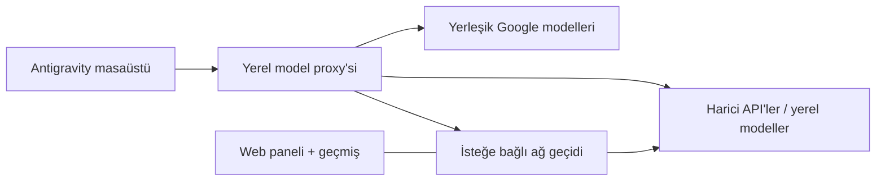

<p align="center">
  
</p>

<h1 align="center">Antigravity Custom Model Enabler</h1>

<p align="center">
  <strong>Kendi sağlayıcıların ve yerel modellerin, Antigravity içinde.</strong><br>
  Masaüstü uygulaması, Antigravity IDE ve isteğe bağlı ağ geçidi için model yönetimi.
</p>

<p align="center">
  <a href="https://github.com/vahapogut/antigravity-add-model/actions/workflows/ci.yml"></a>
  <a href="#installation"></a>
  <a href="LICENSE"></a>
</p>

<p align="center">
  <a href="README.md">English</a> · <a href="README_zh.md">简体中文</a> · <a href="README_es.md">Español</a> · <strong>Türkçe</strong> · <a href="README_ru.md">Русский</a> · <a href="README_hi.md">हिन्दी</a> · <a href="README_ar.md">العربية</a>
</p>

<p align="center">
  <a href="#installation"><strong>Hızlı başlangıç</strong></a> ·
  <a href="#quick-links">Hızlı bağlantılar</a> ·
  <a href="#screenshots">Ekran görüntüleri</a> ·
  <a href="#documentation">Dokümantasyon</a> ·
  <a href="https://github.com/vahapogut/antigravity-add-model/issues/new">Sorun bildir</a>
</p>

---

Antigravity'nin yerleşik modellerinin yanına harici API sağlayıcıları ve yerel modeller ekle. Ayarlardan yapılandır, sohbetin model seçicisinden modeller arasında geçiş yap. İstersen istekleri; geçmiş, yedek sağlayıcılar ve tarayıcı paneli sunan bir ağ geçidi üzerinden yönlendir.

Bu belge Türkçedir. Bağlantı verilen ayrıntılı teknik rehberler İngilizcedir; düğme ve seçenek adları arayüzde göründüğü haliyle korunmuştur.

> [!IMPORTANT]
> **Bağımsız Electron masaüstü ajanı** aşağıdaki ek kurulum yöntemini kullanır. Ayrı bir uygulama olan **VS Code tabanlı Antigravity IDE** ise kendi [ayar adaptörünü ve yerel web yöneticisini](docs/ide.md) kullanır. Windows IDE **2.5.5** üzerinde giriş, yerleşik model seçicisi ve akışlı sohbet, yerel bir OpenAI uyumlu sağlayıcıyla doğrulandı; [doğrulama sonuçlarına](docs/ide.md#validation-boundary) bakabilirsin. Özel model yönlendirmesi yerel oturumlar için geçerlidir; uygulamanın mevcut WSL yönlendirmesi korunur. Kurmadan önce [uyumluluk rehberini](docs/compatibility.md) incele.

<a id="quick-links"></a>

## Hızlı bağlantılar

| Başlangıç | Yapılandırma ve bağlantı | Yardım ve proje |
| --- | --- | --- |
| [Kurulum](#installation) | [Ağ geçidi ve web paneli](#optional-gateway-and-web-dashboard) | [Sorun giderme ve kurtarma](#updates-diagnostics-and-recovery) |
| [İlk modelini ekle](#add-your-first-model) | [Başka bir bilgisayardan bağlan](#connect-from-another-computer) | [Desteklenen sürümler ve kurulum yapıları](docs/compatibility.md) |
| [Sağlayıcılar ve model katalogları](docs/providers.md) | [Model yapılandırması](docs/configuration.md) | [Değişiklik günlüğü](CHANGELOG.md) |
| [Geliştirme ve katkı](#development-and-contributing) | [Google hesap kurulumu](docs/configuration.md#google-cloud-code-account-pools) | [Açılmış sorunlar](https://github.com/vahapogut/antigravity-add-model/issues) |
| [Antigravity IDE kurulumu](docs/ide.md) | [Kaynak koda dayalı özellik karşılaştırması](docs/feature-parity.md) | [IDE durumu ve geri yükleme](docs/ide.md#status-and-recovery) |
| [Cloudflare kurulum sihirbazı](docs/workers-ai-setup.md) | [Yedek model zincirleri](docs/providers.md#fallback-chains-for-rate-limited-providers) | [Yerel proxy güvenliği](docs/compatibility.md#local-proxy-trust-boundary) |

<a id="what-you-can-do"></a>

## Neler yapabilirsin?

| Özellik | Kapsam |
| --- | --- |
| **Modelleri yönet** | Sağlayıcı grupları, arama, düzenleme, çoğaltma, etkinleştirme/devre dışı bırakma ve model keşfi. |
| **Sağlayıcılarını bağla** | OpenAI, Anthropic, Gemini, OpenRouter, [Cloudflare Workers AI](docs/providers.md#cloudflare-workers-ai) ve diğer uyumlu API'ler; Ollama, LM Studio ve vLLM gibi yerel servisler. |
| **İstekleri ayarla** | Protokol seçimi, akıl yürütme ayarları, bağlam/çıktı sınırları, özel başlıklar, zaman aşımı, yeniden deneme, yedek modeller ve devre kesiciler. |
| **Alt ajan modellerini seç** | `invoke_subagent` destekleyen istemcilerde alt ajanlara ayrı yönlendirmeyle özel modeller atanabilir. Antigravity IDE, [özel model MCP araçlarıyla](docs/ide.md#delegate-to-custom-models-with-mcp) bağımsız metin görevlerini başka modellere gönderebilir. |
| **Google hesap havuzları kullan** | Tanınan bir IDE 2.5.5 kurulumuyla [Antigravity hesabına giriş](docs/configuration.md#google-cloud-code-account-pools) veya kendi OAuth istemcin; proje hazırlama, şifreli saklama, kota kontrolü ve duruma göre hesap seçimi. [Gerçek giriş, yenileme ve üretim testleri](docs/configuration.md#verified-google-account-flow). |
| **Hesap kartlarını yönet** | Daraltılabilir kartlar, hesap açma/kapatma, etiket düzenleme, havuzdan kaldırma ve Preferred/Automatic seçimi. Her havuzun projesi ve kotası ayrı kalır; plan rozeti yalnızca sağlayıcı bildirirse gösterilir. Native fallback anahtarı yalnızca tam model eşleşen Cloud Code havuzunu kullanır; public Gemini API'ye geçmez. [Ayrıntılar](docs/configuration.md#quota-panel-and-preferred-accounts). |
| **Görünür sohbet bağlamını tahmin et** | Tanınan yerleşik model seçicisindeki salt okunur halka tahmini `~`, bilinmeyen kullanımı `?` ile gösterir. Gizli istemler, araç tanımları ve görseller dahil değildir. Yapılandırılmış sınır önceliklidir; tıklama eksik sınırı süre/boyut sınırlı models.dev sorgusuyla arar, ayarları kaydetmez. [Kapsam](docs/configuration.md#native-context-estimate). |
| **Doğrudan istekleri incele** | Son istekler, ölçülen gecikme/token kullanımı ve isteğe bağlı küçük bir model yanıtı testi. |
| **Antigravity IDE'yi bağla** | Geri alınabilir ayar adaptörü, projeye ait proxy başlatıcısı ve tarayıcıdan model yönetimi; Windows IDE 2.5.5 üzerinde yerel OpenAI uyumlu sağlayıcıyla yerleşik seçici ve akışlı sohbet doğrulandı. [Kurulum](docs/ide.md). |
| **Yerleşik model seçimlerini sabit tut** | Model takma adları ve akıl yürütme düzeyi varyantları için kalıcı, çakışmayan kimlikler ve belirtilmiş [yerleşik seçici kapasitesi](docs/ide.md#native-model-identities-and-capacity). |
| **Yapılandırmayı paylaş** | Doğrulanan JSON/base64 içe aktarma ve kayıtlı kimlik bilgilerini dışarıda bırakan dışa aktarma. |
| **Web paneli ekle** | Sağlayıcı yönlendirme, istek/oturum geçmişi, yeniden oynatma, grafikler ve maliyet tahmini sunan isteğe bağlı ağ geçidi. |
| **Uzaktan bağlan** | Tünel veya yapılandırılmış ağ adresi üzerinden kimlik doğrulamalı ağ geçidi erişimi. |

Kurulum aracı, uygulamanın mevcut çalışma ortamını koruyarak doğrulanmış bağlantı noktalarını ekler. Sürüme özel yedekler tutar ve başarısız dağıtımları geri alır. Uygulama ayrıntıları ve kapsam için [özellik karşılaştırmasına](docs/feature-parity.md) bak.

<a id="screenshots"></a>

## Ekran görüntüleri

<a id="model-management"></a>

### Model yönetimi

Modellerini ara, sağlayıcıya göre düzenle; bağlantıları tek yerden düzenle, çoğalt veya etkinleştir.

<p align="center">
  <a href="assets/model_manager.jpg"></a>
</p>

*Güncel eklenti kontrolleri, örnek model ayarlarıyla ayrı bir tarayıcı demosunda gösterilmiştir. Tam boyutta görmek için görsele tıkla.*

<a id="model-editor"></a>

### Model düzenleyicisi

Sağlayıcı ve model ayarla, API biçimi seç veya kullanılabilir modelleri keşfet.

<p align="center">
  <a href="assets/model_editor.jpg"></a>
</p>

<a id="remote-gateway"></a>

### Uzak ağ geçidi

Ağ geçidi bağlantısını kaydet, model takma adlarını içe aktar ve yönetim panelini aç.

<p align="center">
  <a href="assets/remote_gateway.jpg"></a>
</p>

<a id="gateway-dashboard"></a>

### Ağ geçidi paneli

İsteğe bağlı web panelinde model takma adlarını sağlayıcılara bağla; yedek modelleri ve bağlam sınırlarını ayarla.

<p align="center">
  <a href="assets/model_gateway.jpg"></a>
</p>

*Yerel test profilindeki güncel ağ geçidi arayüzü; gösterilen model eşlemesi örnektir.*

<details>
<summary><strong>Masaüstü sohbet model seçicisi — önceki sürüm</strong></summary>

<p align="center">
  
</p>

*Önceki bir masaüstü sürümünden örnek. Model adları ve kullanılabilirlik, sağlayıcına ve yapılandırmana bağlıdır.*

</details>

<a id="installation"></a>

## Kurulum

<a id="1-get-the-project-and-build"></a>

### 1. Projeyi indir ve derle

**Bağımsız Antigravity masaüstü uygulaması**, Git ve **Node.js 22.13 veya üzeri** gerekir. Bu Node sürümü hem masaüstü eklentisini hem isteğe bağlı ağ geçidini destekler.

```sh
git clone https://github.com/vahapogut/antigravity-add-model.git
cd antigravity-add-model
npm ci --ignore-scripts
npm run build
```

Depo zaten bilgisayarında mı? Yerel kopyanı güncelle, ardından bağımlılık yükleme ve derleme komutlarını yeniden çalıştır.

**Antigravity IDE** kullanıyorsan aşağıdaki bağımsız uygulama kurulumunun yerine [IDE kurulumuyla](docs/ide.md) devam et. Temel adımlar:

```sh
npm run ide:check -- --resources "/path/to/Antigravity IDE/resources"
npm run ide:apply -- --resources "/path/to/Antigravity IDE/resources"
npm run proxy:start -- --open
npm run ide:launch -- --resources "/path/to/Antigravity IDE/resources"
```

<a id="2-check-and-patch-the-installed-app"></a>

### 2. Kurulu uygulamayı kontrol et ve eklentiyi uygula

Önce Antigravity'yi ve dil sunucusunu kapat. Depo klasöründen çalıştır:

```sh
node scripts/deploy.mjs --check
node scripts/deploy.mjs
```

İlk komut kurulumu değiştirmeden uyumluluğu kontrol eder. İkinci komut eklentiyi uygular. İşlem başarıyla tamamlanınca Antigravity'yi yeniden aç.

Otomatik algılama uygulamayı bulamazsa iki komutta da aynı açık yolu belirt:

```sh
node scripts/deploy.mjs --check --resources "/path/to/Antigravity/resources"
node scripts/deploy.mjs --resources "/path/to/Antigravity/resources"
```

`--resources`; Resources klasörünü, kurulum klasörünü veya macOS `.app` klasörünü kabul eder. Tanınmayan kurulum yapıları, uygulama dosyaları değiştirilmeden reddedilir.

<details>
<summary><strong>Platform betikleri ve isteğe bağlı Windows uç nokta yaması</strong></summary>

Bu betikler aynı kurulum aracını çağırır ve aynı argümanları kabul eder.

| Platform | Betik |
| --- | --- |
| Windows / PowerShell | `./deploy.ps1` |
| macOS bağımsız uygulaması | `bash deploy.sh` |
| Linux | `bash deploy_linux.sh` |

Tanınan bazı Windows dil sunucusu ikilileri, yapılandırılabilir model listesi adresini kullanmaz. Bu sürümlerde isteğe bağlı ikili yamayı kontrol edip uygulayabilirsin:

```powershell
.\deploy.ps1 --check --patch-language-server
.\deploy.ps1 --patch-language-server
```

Bu seçenek **50999** portunu gerektirir ve yedekleme/geri alma sürecine dahildir. Yalnızca tanınan Windows ikilileri içindir. [Windows uç nokta yamasına](docs/compatibility.md#optional-windows-language-server-endpoint-patch) bak.

</details>

<a id="add-your-first-model"></a>

## İlk modelini ekle

1. **Settings → Models & Usage** bölümünü aç; eski arayüzlerde adı **Models** olabilir.
2. **Custom Models** içinden **Add model** seçeneğini seç ve sağlayıcını belirle.
3. Gerektiğinde **API URL** ve **API key** alanlarını doldur.
4. Aşağıdaki yöntemlerden biriyle model ekle, ardından kaydedilen modeli sohbet seçicisinden seç.

| Yöntem | Adımlar |
| --- | --- |
| **Modeli elle ekle** | Tam **Provider model ID** değerini gir, istersen görünen adı ayarla, ardından **Test connection → Save model** seçeneklerini kullan. |
| **Sağlayıcı kataloğundan seç** | **Fetch provider models** seçeneğini kullan, ad veya kimlikle ara, modelleri işaretle ya da **Select filtered** ile filtrelenenleri seç, ardından **Add selected** düğmesine bas. |

**Yerel model mi kullanıyorsun?** Önce yerel sunucunu başlat, sonra **Discover local** seçeneğini kullan. Keşif, yaygın portları yalnızca istendiğinde kontrol eder.

**Cloudflare Workers AI mı kullanıyorsun?** Hesap seçimi, sınırlı yetkili token oluşturma veya mevcut token kullanımı ve model seçimi için `npm run workers-ai:setup -- wizard` çalıştır. İsteğe bağlı yardımcı, kayıtlı kimlik bilgilerini şifreler ve bir hesabın kayıtlarındaki token'ı yenileyebilir. [Kurulum, izinler ve doğrulama kapsamına](docs/workers-ai-setup.md) bak.

**Ayarları başka bir bilgisayara mı taşıyorsun?** **Export** ve **Import** seçeneklerini kullan. Dışa aktarılan yapılandırmalar API anahtarlarını, özel başlıkları ve Google token/istemci sırlarını içermez; bunları hedef bilgisayarda yeniden gir.

> [!NOTE]
> Başarılı bir bağlantı testi model listesine erişimi ve kimlik doğrulamayı kontrol eder. Yanıt üretmez ve hesabın üretim kotasına sahip olduğunu kanıtlamaz. Model listeleme adresi sunmayan sağlayıcılar da elle yapılandırılabilir.

<a id="providers-and-advanced-options"></a>

### Sağlayıcılar ve gelişmiş seçenekler

| Bağlantı | Hazır sağlayıcı kataloğundan örnekler |
| --- | --- |
| Çok modelli servisler | OpenRouter, Together AI, Hugging Face Inference Providers, Fireworks AI, SiliconFlow, Novita AI |
| Doğrudan barındırılan API'ler | OpenAI, Anthropic, Google Gemini, DeepSeek, Groq, Mistral, xAI, Cerebras, SambaNova, Alibaba Cloud Model Studio, NVIDIA NIM |
| Yerel sunucular | Ollama, LM Studio, llama.cpp, vLLM, LocalAI, TabbyAPI, Text Generation WebUI |
| Diğer uç noktalar | LiteLLM, uyumlu özel uç noktalar veya kimlik doğrulamalı model ağ geçidi |

Hazır seçenekler varsayılan değerleri doldurur; isteklerin nasıl dönüştürüleceğini **API format** belirler. Model kimlikleri ve erişim sağlayıcıya bağlıdır. Tam liste [sağlayıcı kataloğundadır](src/providers.ts).

**Yüzlerce model seçeneği mi istiyorsun?** OpenRouter ve diğer çok modelli servisler, **Fetch provider models** üzerinden güncel kataloglarını sunar. İhtiyacın olan modelleri ara ve seç; eklenti, belirlediğin özel değerleri koruyarak mevcut bağlam/çıktı sınırlarını ve görüntü/akıl yürütme bilgilerini içe aktarır. Kataloglar zamanla değişir; listelenen bir model için yine de hesap erişimi ve görevine uygun yetenekler gerekir. [Sağlayıcı kurulumu ve model keşfine](docs/providers.md) bak.

**Görüntü işleyen bir model mi kullanıyorsun?** Masaüstü proxy'si, uyumlu DeepSeek görüntü modelleri dahil OpenAI ve Anthropic uyumlu uç noktalara görüntü girdilerini iletir. Yetenek ayarları, desteklenen biçimler ve uç nokta gereksinimleri için [görüntü girdisi kurulumuna](docs/configuration.md#image-inputs) bak.

İstek sınırları, akıl yürütme, başlıklar, yedek modeller ve diğer özel değerler için **Advanced settings** bölümünü aç. Alan açıklamaları ve örnek içe aktarma dosyası [yapılandırma rehberindedir](docs/configuration.md).

Google hesap havuzu için **Google Cloud Code account pool** seçeneğini seç ve [hesap kurulum rehberini](docs/configuration.md#google-cloud-code-account-pools) izle. Tanınan bir IDE **2.5.5** kurulumuyla **Antigravity account** üzerinden giriş yapabilir veya **My Desktop OAuth client** seçeneğiyle kendi istemcini kullanabilirsin. Hesabın ve servisin uygunluğunu sağlayıcı belirler.

<a id="optional-gateway-and-web-dashboard"></a>

## İsteğe bağlı ağ geçidi ve web paneli

Masaüstü eklentisi sağlayıcılarına doğrudan bağlanabilir. Merkezi yönlendirme, tarayıcıdan yönetim, istek geçmişi veya uzak bağlantı adresi istiyorsan ağ geçidini ekle.

```sh
npm run gateway:install
npm run gateway:build
npm run gateway -- setup --non-interactive
npm run gateway -- start
```

Kurulum, oluşturulan ağ geçidi token'ını ve panel giriş bilgilerini yerel terminalde gösterir. **http://127.0.0.1:51001** adresini aç, giriş yap, sağlayıcı kimlik bilgilerini ve model takma adlarını ayarlayıp kaydet.

Masaüstündeki **Remote gateway** penceresine şu değerleri gir:

| Alan | Yerel kurulum |
| --- | --- |
| Gateway URL | `http://127.0.0.1:51000` |
| Gateway token | Kurulumun gösterdiği token |
| Dashboard URL | `http://127.0.0.1:51001` |

**Test gateway**, ardından **Import model aliases** seçeneklerini kullan. İçe aktarılan modeller masaüstü seçicisinde görünür. **Open dashboard**, kayıtlı panel adresini açar.

<details>
<summary><strong>Ağ geçidi komutları</strong></summary>

```sh
npm run gateway -- status
npm run gateway -- logs
npm run gateway -- stop
```

Panelden kaydedilen sağlayıcı/model değişiklikleri hemen yüklenir. Dinleme adresi ve port değişiklikleri yeniden başlatma gerektirir. Geçmiş; istemleri, yanıtları ve araç argümanlarını içerir; maliyet toplamları tahminidir.

</details>

<a id="connect-from-another-computer"></a>

### Başka bir bilgisayardan bağlan

Ağ geçidini sağlayıcılara erişebilen bilgisayarda çalıştır. İstemci bilgisayarda iki portu da SSH üzerinden yönlendir:

```sh
ssh -N -L 51000:127.0.0.1:51000 -L 51001:127.0.0.1:51001 user@gateway-host
```

Tüneli açık tut ve yukarıdaki tablodaki yerel adresleri kullan. Ağ geçidinin iki dinleyicisi de varsayılan olarak yalnızca yerel geri döngü adresine bağlanır. Belirli bir ağ adresinde dinleme veya HTTPS ters proxy için [uzak erişim rehberine](gateway/README.md#remote-access) bak.

<a id="how-it-fits-together"></a>

## Bileşenler nasıl çalışır?



Eklenti, uygulamanın mevcut çalışma ortamını koruyarak Ayarlar kontrollerini ekler. Ağ geçidi ayrı bir Node süreci olarak çalışır ve kendi veri klasörünü kullanır.

<a id="updates-diagnostics-and-recovery"></a>

## Güncelleme, tanılama ve kurtarma

Antigravity güncellendikten sonra eklentiyi yeniden derle ve tekrar uygulamadan önce uyumluluk kontrolünü çalıştır.

| İhtiyaç | Komut |
| --- | --- |
| Derlemeyi, model yapılandırmasını ve yerel servisleri kontrol et | `npm run doctor` |
| Tanılama sonuçlarını JSON olarak al | `npm run doctor -- --json` |
| Belirli bir kurulumu kontrol et | `npm run patch:check -- --resources "/path/to/Resources"` |
| Eklentiyi desteklenen bir kuruluma yeniden uygula | `npm run doctor:repair -- --resources "/path/to/Resources"` |
| Bu kurulum aracının oluşturduğu yedeği geri yükle | `npm run patch:restore -- --resources "/path/to/Resources"` |

Onarmadan veya geri yüklemeden önce uygulamayı kapat. Gerektiğinde Windows uç nokta seçeneğini kullan. Geri yükleme, sonraki bir resmi güncellemenin değiştirdiği kurulumun üzerine yazmayı reddeder.

| Belirti | İlk kontrol |
| --- | --- |
| Kurulum aracı `NOT_SUPPORTED` veya `UNSUPPORTED_RUNTIME` bildiriyor | Bağımsız uygulamayı kullandığını doğrula ve [desteklenen kurulum yapılarını](docs/compatibility.md) kontrol et. |
| Güncellemeden sonra siyah ekran | [Başlangıç kurtarma adımlarını](docs/compatibility.md#black-screen-after-an-update) izle; rastgele eski bir arşivi geri yükleme. |
| Bir model görünmüyor | Etkin olduğunu, kaydedildiğini ve doğru sağlayıcı model kimliğini kullandığını kontrol et. |
| Sağlayıcı 401, 403 veya 404 döndürüyor | Kimlik bilgilerini, hesap erişimini/bölgeyi, API adresini ve modelin kullanılabilirliğini kontrol et. |
| 50999 portu kullanımda | İkili yama uygulanmış Windows kurulumu bu sabit portu gerektirir; yamasız normal kullanım başka bir port seçebilir. |
| TLS bağlantısı başarısız | Uç noktanın sertifikasını ve güvenilen sertifika yetkilisi (CA) ayarlarını kontrol et. |

Ayrıntılar: [uyumluluk ve kurtarma](docs/compatibility.md) · [model yapılandırması](docs/configuration.md)

<a id="credentials-and-data"></a>

## Kimlik bilgileri ve veriler

| Bileşen | Saklanan veriler ve davranış |
| --- | --- |
| Masaüstü eklentisi | Modeller `~/.gemini/antigravity/custom_models.json` dosyasında tutulur. Kayıtlı API anahtarları, başlıklar, ağ geçidi token'ları ve Google kimlik bilgileri şifrelenir ve düzenleyicide maskelenir. |
| Yedek şifreleme yöntemi | İşletim sistemi destekli saklama kullanılamadığında yerel AES-256-GCM, `~/.gemini/antigravity/.model-credentials-key` dosyasını kullanır. Bu anahtarı özel yedeklerinle birlikte sakla. |
| Model dışa aktarma | Kayıtlı API anahtarları, özel başlıklar ve Google token/istemci sırları çıkarılır. Normal yapılandırma alanları korunur. |
| İsteğe bağlı ağ geçidi | Kendi `~/.gemini/antigravity/gateway` profilini kullanır. Kimlik bilgileri yapılandırması Electron saklama alanından ayrıdır; geçmiş, istek ve yanıt içeriğini kapsar. |

Model ayarlarını paylaşmak için **Export** kullan. Yerel profilleri kopyalamadan önce [verilerin işlenmesi](docs/configuration.md#credentials-and-data) ve [ağ geçidi saklama alanı](gateway/README.md#lifecycle-and-data) bölümlerini incele.

<a id="documentation"></a>

## Dokümantasyon

| Rehber | Kapsam |
| --- | --- |
| [Yapılandırma rehberi](docs/configuration.md) | Model alanları, içe aktarma biçimi, Google hesapları ve kimlik bilgileri |
| [Sağlayıcılar ve model katalogları](docs/providers.md) | Yaygın servisler, API adresleri, geniş katalog keşfi ve hesap gereksinimleri |
| [Cloudflare kurulum sihirbazı](docs/workers-ai-setup.md) | Hesap seçimi, sınırlı yetkili token'lar, şifreli model içe aktarma ve hesaba özel token yenileme |
| [Ağ geçidi rehberi](gateway/README.md) | Kurulum, yönlendirme, panel, servis yönetimi ve uzak erişim |
| [Uyumluluk ve kurtarma](docs/compatibility.md) | Desteklenen kurulum yapıları, güncellemeler, yedekler ve sorun giderme |
| [Özellik karşılaştırması](docs/feature-parity.md) | Referans depolar, eklenen özellikler ve kalan farklar |
| [Değişiklik günlüğü](CHANGELOG.md) | Güncel değişiklikler ve eski sürüm notları |
| [Ağ geçidi kaynak bilgileri](gateway/UPSTREAM.md) | Kaynak sürümü ve korunan lisans bildirimleri |

<a id="development-and-contributing"></a>

## Geliştirme ve katkı

Masaüstü eklentisi `src/` içindeki TypeScript kodundan, sürüm kontrolünde tutulan `dist/` klasörüne derlenir. İsteğe bağlı ağ geçidinin `gateway/` içinde ayrı paketi vardır.

```sh
npm ci --ignore-scripts
npm run build
npm test
npm run lint
```

Ağ geçidi veya entegrasyon değişiklikleri için:

```sh
npm run gateway:install
npm run gateway:build
npm run gateway:test
npm run test:integration
```

CI; yerel test sağlayıcıları ve ayrı kurulum paketleri kullanarak Windows, macOS ve Linux üzerinde çalışır. Gerçek sağlayıcı kimlik bilgilerini veya gelecekteki tüm Antigravity sürümlerini doğrulamaz.

Yeni bir sağlayıcı eklemek için [masaüstü sağlayıcı kataloğundan](src/providers.ts), [protokol kaydından](src/proxy/registry.ts) ve [ağ geçidi sağlayıcı kataloğundan](gateway/src/provider-catalog.ts) başla. Değişiklikler ilgili testleri ve yeniden derlenmiş masaüstü çıktısını içermelidir. Pull request gönderebilirsin; tekrarlanabilir hatalar için uygulama türünü/sürümünü, işletim sistemini ve tanılama bilgilerini ekleyerek [issue aç](https://github.com/vahapogut/antigravity-add-model/issues).

<a id="license-and-credits"></a>

## Lisans ve kaynaklar

[Apache Lisansı 2.0](LICENSE). Uyarlanan ağ geçidi bileşenlerinin [MIT lisansı](gateway/LICENSE.upstream) ve [kaynak atıfları](gateway/UPSTREAM.md) korunur.

Antigravity logosu [Google'ın resmi basın materyallerinden](https://antigravity.google/press) alınmıştır.

Bakımını yapan: **[vahapogut](https://github.com/vahapogut)** · [LinkedIn](https://www.linkedin.com/in/abdulvahap-ogut-343992398/)

<p align="center"><a href="#quick-links">↑ Hızlı bağlantılara dön</a></p>
